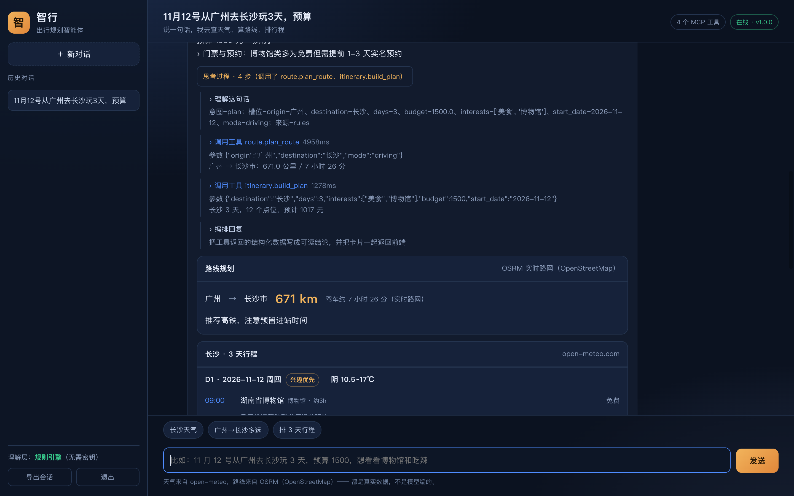

# 智行 · 出行规划智能体

> **你说一句，我做一路。**
> 广东工业大学 计算机学院 计科 24 级 78 班 · 软件工程 · 团队项目
> 需求文档：[docs/需求规格说明书.md](docs/需求规格说明书.md)　｜　[团队展示与选题报告](docs/团队展示与选题报告.md)　｜　[博客随笔](docs/博客随笔.md)

用户用自然语言说需求，智能体自己决定查什么、按什么顺序查，调用真实接口拿数据，最后交付一份**能直接发给同伴的攻略文件**——不是只在聊天框里贴一堆卡片。

三件事是真的：**天气**（open-meteo 16 天预报）、**里程**（OSRM 真实路网）、**地点**（高德 POI，配 Key 后全国可搜）。每次调用了哪个工具、参数是什么、花了多少毫秒，都能展开「思考过程」核对。


| | |
|---|---|
| [](docs/screenshots/00-login.png) | [](docs/screenshots/02-steps.png) |
| 登录 / 注册 | 工具调用轨迹 |

---

## 目录

1. [项目概览](#1-项目概览)
2. [快速开始](#2-快速开始)
3. [配置参考](#3-配置参考)
4. [功能详解](#4-功能详解)
5. [架构](#5-架构)
6. [API 参考](#6-api-参考)
7. [MCP 工具](#7-mcp-工具)
8. [验收与质量](#8-验收与质量)
9. [ChinaTravel benchmark 评测尝试](#9-chinatravel-benchmark-评测尝试)
10. [开发指南](#10-开发指南)
11. [演示脚本](#11-演示脚本答辩用)
12. [目录结构](#12-目录结构)
13. [已知局限](#13-已知局限)
14. [常见问题](#14-常见问题)
15. [版本记录](#15-版本记录)
16. [声明](#16-声明)

---

## 1 项目概览

### 1.1 它解决什么问题

普通的旅行问答有两个极端：一类是纯聊天模型，景点、天气、票价全靠编；另一类是固定表单，用户得自己填城市、天数、偏好，问一句「明天会不会下雨」都走不通整套流程。

智行走中间那条路：**用自然语言进来，用结构化数据出去**。模型负责理解意图和编排工具，所有事实性内容（天气、坐标、评分、里程、门票）都必须来自工具返回。工具没查到就说没查到，不允许用想象补。

### 1.2 与参照项目的对比结论

我们逐行读了 [hello-agents 第 13 章的 trip-planner](https://github.com/datawhalechina/hello-agents/tree/main/code/chapter13/helloagents-trip-planner) 作为参照。结论和最初的直觉相反：

> **瓶颈不在 Agent 架构，在数据真实性。**

参照项目对外宣称的高德服务是空壳（`amap_service.py` 四个方法全部 `return []` / `{}` / `None`），真正出数据的路径是在 system prompt 里手写 `[TOOL_CALL:...]` 再用正则抠出来执行——那是提示词模拟工具协议，不是 function calling。它的兜底更严重：直接造 `北京景点1`、坐标按 `116.4 + i*0.01` 递增。

| 维度 | 参照项目 | 智行 |
|---|---|---|
| 数据来源 | LLM 填模板 + 兜底编造 | open-meteo / OSRM / 高德实时接口 |
| 工具协议 | 提示词 + 正则 | MCP 标准 JSON-RPC + Pi function calling |
| 失败处理 | 编 `北京景点1` | 标注「未取到」，降级数据集显式标「示例数据」 |
| 鉴权 / 持久化 | 无，结果存 sessionStorage | SQLite 账号 / 会话 / 消息 / 长期记忆，按用户隔离 |
| 依赖 | FastAPI + Vue + 多个包 | Python 标准库 + 原生 JS；Node 只给 Pi 用 |
| 呈现 | 高德 JS API 地图、图片、导出 | 独立攻略 HTML（含 Leaflet 地图）、docx、PNG、PDF |

它比我们好看的地方（分阶段进度条、可编辑行程、锚点导航）后来都补上了，见 §4。详细对比另见仓库外的 [对比分析与重构方案.md](../对比分析与重构方案.md)。

### 1.3 四条设计原则

| 原则 | 具体含义 | 代码里在哪体现 |
|---|---|---|
| **诚实优先** | 估算标估算，没取到说没取到，降级标来源 | `poi.py` 的 `source` 字段、`hotel.py` 的 `price_estimated`、`SYSTEM.md` 硬性规则 1/3/4 |
| **零 Python 依赖** | `python server.py` 一条命令能起，机房断网装不上 pip 也能演示 | `requirements.txt` 里一行依赖都没有，`mcp/net.py` 用 `urllib` |
| **工具层标准化** | 同一份工具表既能给 Pi 用，也能挂 Claude Desktop | `mcp/registry.py` 输出 MCP 标准 `inputSchema` |
| **一套输出结构** | Pi 链路和降级链路都产出 `(reply, steps, cards)`，前端不区分 | `agent/orchestrator.py` 的 `_pack()` |

### 1.4 规模与技术栈

| 层 | 选型 | 说明 |
|---|---|---|
| 后端 | Python 3.11+ 标准库 `ThreadingHTTPServer` | 单文件 `server.py`，路由 / 鉴权 / 静态 / SSE / MCP 网关 |
| 智能体 | [Pi](https://github.com/earendil-works/pi) 1.5.0（TypeScript，MIT） | `--mode rpc` 子进程，JSONL over stdin/stdout |
| 工具协议 | MCP stdio（JSON-RPC 2.0） | 自实现 `initialize / tools/list / tools/call / ping` |
| 前端 | 原生 HTML / CSS / JS，无构建 | `index.html` 178 行、`style.css` 531 行、`app.js` 约 1300 行 |
| 存储 | SQLite（WAL） | 5 张表，见 §5.5 |
| 外部服务 | open-meteo、OSRM、高德 Web 服务、百炼 OpenAI 兼容端点 | 全部 `urllib` 直连 |
| 代码量 | 约 **7200 行**（含测试与文档） | 9 个 MCP 工具、25 个 HTTP 端点、62 项验收断言 |

---

## 2 快速开始

### 2.1 前置条件矩阵

| 需要 | 用来做什么 | 缺了会怎样 |
|---|---|---|
| **Node 22+** + `pi` | 智能体引擎（Pi agent harness） | 自动走**降级模式**：规则理解 + 真实工具调用，仍能出完整攻略文件 |
| **模型凭据** | Pi 调用大模型做决策 | 同上，回复末尾明确标注「不是 Pi 智能体」 |
| **`AMAP_KEY`** | 高德 POI 检索（全国地点 + 坐标） | POI 退回 `data/cities.json` 的 9 城示例，界面标注「示例数据」，**地图画不出来**（示例点位没有经纬度） |

也就是说：**没有 Node 和模型 Key 也能完整演示**，只是少了「模型自己决定调哪个工具」这一层。工具、数据、攻略文件、预算都是真的。这条降级路径是刻意留的——答辩现场额度挂了不至于开天窗。

Python 侧**零依赖**，`pip install` 什么都不用装（`requirements.txt` 是一份说明文件）。

### 2.2 五步安装

```bash
# 1) 装 Node 22+ 和 pi 引擎
npm i -g @earendil-works/pi-coding-agent@1.5.0
pi --version                       # 确认在 PATH 里

# 2) 配 Pi 的模型 provider（见 §2.4）
#    编辑 ~/.pi/agent/models.json，用 $环境变量 插值读 Key，不要把 Key 写死

# 3) 把智行的 MCP server 挂给 Pi（见 §2.4）
#    编辑 ~/.pi/agent/mcp.json，exposure 必须是 "direct"

# 4) 在项目根建 .env（见 §2.3 和 §3.2）

# 5) 起服务
cd zhixing-travel-agent
python server.py                   # Windows 用 python，Linux/macOS 用 python3
```

打开 <http://127.0.0.1:8000>，体验账号 `demo` / `demo1234`。

启动后终端会打印引擎状态、工具数量、体验账号。想让别人从手机访问：

```bash
BIND=0.0.0.0 python server.py
```

### 2.3 高德 Key 怎么申请

`poi.search_places` / `hotel.search` / `poi.geocode` 都走高德 Web 服务。申请步骤：

1. 打开 <https://lbs.amap.com/>，手机号注册个人开发者
2. 完成**实名认证**（个人用身份证），不做这步拿不到 Web 服务权限
3. 进控制台 <https://console.amap.com/dev/key/app>
4. 「应用管理 → 我的应用 → 创建新应用」，名称随便填
5. 点「添加 Key」，**服务平台必须选「Web服务」**

> ⚠️ 第 5 步最容易错：选成「Web端(JS API)」的 Key 不通用，后端调 `restapi.amap.com` 会直接鉴权失败。我们是服务端用 `urllib` 发 HTTP 请求，属于 Web 服务。

拿到 32 位 Key 后填进 `.env` 的 `AMAP_KEY`，重启服务生效。个人 Key 有日额度和 QPS 限制，`poi.py` 里做了关键词间 0.15 秒间隔和限流重试（`CUQPS_HAS_EXCEEDED_THE_LIMIT` 时等 0.8 秒）。

### 2.4 模型配置：Pi 的两个文件

**`~/.pi/agent/models.json`** —— 定义 provider 和可用模型。以阿里云百炼的 OpenAI 兼容端点为例：

```json
{
  "$schema": "https://pi.dev/schemas/models.schema.json",
  "providers": {
    "dashscope": {
      "baseUrl": "https://dashscope.aliyuncs.com/compatible-mode/v1",
      "api": "openai-completions",
      "apiKey": "$DASHSCOPE_API_KEY",
      "models": [
        { "id": "deepseek-v4.1-flash", "name": "DeepSeek V4.1 Flash (百炼)" },
        { "id": "deepseek-v4-pro", "name": "DeepSeek V4 Pro (百炼)" }
      ]
    }
  }
}
```

`apiKey` 写 `$DASHSCOPE_API_KEY`，Pi 会从环境变量插值读取——**Key 不落进任何配置文件**。也可以直接用 Pi 内置的 `anthropic` / `openai` 等 provider，配对应的 `ANTHROPIC_API_KEY` / `OPENAI_API_KEY` 即可。

**`~/.pi/agent/mcp.json`** —— 把智行的工具挂给 Pi：

```json
{
  "mcpServers": {
    "zhixing": {
      "command": "python",
      "args": ["C:/path/to/zhixing-travel-agent/mcp/server_stdio.py"],
      "exposure": "direct",
      "description": "智行出行规划工具：城市地理编码、天气、城际路线、逐日行程"
    }
  }
}
```

> ⚠️ `exposure` 默认是 `codemode`，配合 `--no-builtin-tools` 会报 "MCP tools are only reachable from the codemode…"，**必须显式设为 `direct`**。
> 也可以命令行一把梭：`pi mcp add zhixing -- python /path/to/mcp/server_stdio.py`。

验证挂载：

```bash
pi mcp list
# zhixing: connected, 9 tools (direct, global)
```

Pi 会把工具名规范化：点号不合法，`weather.get_forecast` → `mcp__zhixing__weather_get_forecast`。`pi_bridge.py` 里有映射表还原成原名给前端显示。

### 2.5 装完的验证清单

| 检查 | 期望 |
|---|---|
| `curl localhost:8000/api/health` | `{"ok": true, "version": "1.0.0"}` |
| `curl localhost:8000/api/status` | `engine.llm_enabled = true`，`tools = 9` |
| `pi mcp list` | `connected, 9 tools (direct, global)` |
| 网页问「长沙未来三天天气」 | 出天气数据，`intent = pi` |
| 网页问「帮我排泉州 2 天行程」 | 出**文件卡片**，点开有 8 个区块的攻略 |
| `python tests/acceptance.py` | 62 项通过 |

---

## 3 配置参考

### 3.1 环境变量全表

全部可用环境变量覆盖，**不需要改源码**。`.env` 在启动时由 `config.py` 自动加载。

| 变量 | 默认值 | 说明 |
|---|---|---|
| `PORT` | `8000` | HTTP 端口 |
| `BIND` | `127.0.0.1` | 设 `0.0.0.0` 允许局域网访问 |
| `DB_PATH` | `data/zhixing.db` | SQLite 文件位置 |
| `DASHSCOPE_API_KEY` | 空 | 百炼 Key；可被 `LLM_API_KEY` 覆盖，也是 Pi `models.json` 的插值来源 |
| `LLM_API_KEY` | 空 | 通用模型 Key（优先于 `DASHSCOPE_API_KEY`） |
| `LLM_BASE_URL` | `https://api.deepseek.com/v1` | OpenAI 兼容端点；配百炼要改成 dashscope 地址 |
| `LLM_MODEL` | `deepseek-chat` | 记忆抽取、标题概括、专家会诊用的模型 |
| `LLM_PROVIDER` | `auto` | 保留字段 |
| `LLM_TIMEOUT` | `25` | 单次轻量模型调用超时（秒） |
| `AMAP_KEY` | 空 | 高德 Web 服务 Key，见 §2.3 |
| `PI_BIN` | `pi` | pi 可执行文件；没全局装可写 `node /path/to/cli.js` |
| `PI_PROVIDER` | 空 | provider 名，如 `dashscope` / `anthropic` |
| `PI_MODEL` | 空 | 模型 ID，如 `deepseek-v4.1-flash` |
| `PI_TIMEOUT` | `120` | 单轮对话等待上限（秒） |
| `PI_MAX_SESSIONS` | `6` | 同时存活的 Pi 子进程上限，LRU 淘汰 |
| `OSRM_URL` | `http://router.project-osrm.org/route/v1/driving` | 路网服务；用 http 是因为 macOS 自带 Python 3.9 链 LibreSSL |
| `HTTP_TIMEOUT` | `12` | 外部接口超时（秒） |
| `ALLOW_OFFLINE_FALLBACK` | `1` | 工具失败时是否允许用离线兜底数据 |

### 3.2 `.env` 模板

项目根的 `.env` 已在 `.gitignore`，**不会入库**。照这个填：

```ini
# 模型（阿里云百炼 OpenAI 兼容端点）
DASHSCOPE_API_KEY=sk-xxxxxxxxxxxxxxxx
LLM_BASE_URL=https://dashscope.aliyuncs.com/compatible-mode/v1
LLM_MODEL=deepseek-v4.1-flash
PI_PROVIDER=dashscope
PI_MODEL=deepseek-v4.1-flash

# 高德 Web 服务 Key
AMAP_KEY=你的32位key
```

设置页（§4.10）能在运行时改 `DASHSCOPE_API_KEY` / `LLM_API_KEY` / `AMAP_KEY` / `LLM_MODEL` / `PI_MODEL`，写回 `.env` 并重建引擎进程，不用手改文件、不用重启。Key 只以 `7fce****4954` 形式回显。

### 3.3 部署

| 场景 | 做法 |
|---|---|
| 本机 / 答辩机房 | `python server.py`，最稳。没网也能演示降级模式 |
| 局域网（手机同屏） | `BIND=0.0.0.0 python server.py`，访问 `http://<本机IP>:8000` |
| Render Blueprint | 仓库自带 `render.yaml`，连到 Render → New → Blueprint → 选仓库 |

> ⚠️ **Render 部署的已知限制**：`render.yaml` 只声明了 Python 运行时，没有装 Node 和 pi。免费层会走降级模式，能演示但不能体现智能体。要完整部署需自己改 Blueprint 加 `npm i -g` 步骤，或用 Docker 镜像同时装 Node 22 + Python。

---

## 4 功能详解

### 4.1 对话能力矩阵

| 你说 | 它做 |
|---|---|
| 长沙未来三天天气 | `weather.get_forecast`，真实预报 + 带伞建议 |
| 从广州到长沙开车多久 | `route.plan_route`，OSRM 真实路网里程与耗时，长途会提示「该改高铁」 |
| 帮我排泉州 2 天行程，预算 1200，想看古建筑 | `itinerary.build_plan`，逐日安排 + 三餐 + 酒店 + 四项预算，**自动产出攻略 HTML / docx** |
| 做一份能直接照着走的完整攻略 | 先 `expert.convene` 四位专家会诊，再排行程，意见由主智能体消化进回答 |
| 帮我排个行程 | 不猜城市，直接追问目的地 |
| 我常住广州，预算一般 1500 | 抽成长期记忆，之后新会话也带着 |
| 那第二天呢 | 靠 Pi 的 `--session-id` 会话上下文接住，不用重说城市 |

排行程时会读未来天气：**那天下雨就换室内点位**；室内点位排完了会如实说「剩余请按天气取舍」，不假装排得下。

预算拆四项：**门票 / 住宿 / 餐饮 / 市内交通**。住宿价按档位估算并标注「估算」，门票取高德 `biz_ext.cost`（人均消费，餐饮类会被排除），多数景点该字段为空——不拿编出来的数字充准确。

### 4.2 两条引擎链路，一套输出

```
                    ┌─ 有 pi + 模型凭据且近期没报错 → Pi 智能体
用户输入 ───────────┤                                  （自己决定调哪个工具、几次、什么顺序）
                    └─ 否则 → agent/fallback.py
                                  （规则理解 + 直接调工具）
                              ↓
                  都是 (reply, steps, cards)
                  前端不区分，只在回复末尾标注是否降级
```

降级触发条件：Pi 不在 PATH、模型凭据报 401/403、Pi 进程异常退出、本轮没有任何输出。模型硬报错后会**冷却 120 秒**，期间直接走降级，不再每轮白等一次失败；配好 Key 后等两分钟或重启服务即可切回。

降级模式不冒充智能体：回复末尾有一段 `> 当前为降级模式…`，步骤区第一条也是显式的「降级模式」卡片。

### 4.3 流式进度与思考轨迹

`POST /api/chat/stream` 是 SSE。后端把 Pi 的 JSONL 事件流实时转给浏览器：

| 事件 | 载荷 | 界面表现 |
|---|---|---|
| `hello` | `session_id` | 建立本轮会话 |
| `stage` | 文字 | 进度条文案，如「理解你的需求」 |
| `tool` (`phase=start/end`) | `name` / `args` / `ok` / `ms` | 「正在调用 weather.get_forecast（第 1 个工具）…」 |
| `delta` | 文本块 | 打字机逐字输出 |
| `done` | 完整 `result` + `session_id` | 渲染最终消息与文件卡片 |
| `error` | 错误信息 | 显示失败原因 |

**不是假的进度动画**——每个工具步都带真实参数、成功与否和耗时，点「思考过程」能逐条核对。

### 4.4 双击 ESC 打断

第一次按提示「再按一次 ESC 可以打断」，800ms 内再按就发 `POST /api/chat/abort`。后端对对应 Pi 会话发 RPC `abort` 命令，已输出的文字保留，末尾标「已打断」。打断过的进程下一轮自动重建，避免状态不干净。

### 4.5 长期记忆：Pi 做什么、我们补什么

先查清楚了再动手，没重复造轮子：

| 层 | Pi 有没有 | 我们怎么做 |
|---|---|---|
| 会话内多轮 | ✅ `--session-id` + `--session-dir` 落盘 | **直接用**，一行历史拼接都没写。实测第二问能答出第一问说的「广州、1500」 |
| 跨会话用户档案 | ❌ | SQLite `memories` 表 + 每轮注入 |

跨会话这层：

```
用户说「我常住广州，预算一般 1500」
        ↓ 规则预筛（命中「我住 / 我预算」等词才触发，省钱）
        ↓ 一次独立的轻量模型调用抽成 {key: 常住城市, value: 广州}
   SQLite memories 表（UNIQUE(user_id, key)，按用户隔离）
        ↓ 每轮对话前
   prompt 前缀 [我对你的长期了解] → Pi
```

抽取**异步**执行，不拖慢回复；抽失败静默跳过。设置页「长期记忆」标签页能看全部、手动增删、一键清空。

### 4.6 会话管理与标题

- 侧边栏会话项悬停出现 `⋯`：重命名 / 导出 Markdown / 删除（二次确认）
- 标题不再截首句前 18 字。首轮答完后后台起线程，把「用户原话 + 回答开头」交给模型概括成 ≤12 字

```
帮我排泉州两天行程，预算1200，想看古建筑  →  泉州两日古建筑攻略
长沙未来三天天气怎么样                     →  长沙未来三天天气查询
从广州到长沙怎么走，开车要多久              →  广州到长沙自驾路线时长
```

约 2 秒写库，前端 6 秒后刷一次列表。模型失败就保留截断标题，**绝不因为起标题把对话搞挂**。

### 4.7 文件上传

输入框左侧 `+`，单文件 8MB 以内：

| 类型 | 处理方式 |
|---|---|
| png / jpg / webp / gif | 转 base64 调视觉模型描述（实测能认出地图上的道路和地名），把描述注入对话 |
| txt / md / csv / json | 直接读文本 |
| docx | 解 zip 读 `word/document.xml`，按 `<w:t>` 抽正文 |
| pdf | 解 FlateDecode 流抓 `Tj/TJ` 文本；扫描件抽不出会明确告知 |

**为什么不直接把图片塞给 Pi**：Pi 的 RPC `prompt` 只接受字符串，塞不进二进制。所以服务端先把图片转成文字描述再注入，Pi 那边一行没改。

### 4.8 专家会诊：四位专家，模型自己决定要不要开

固定流水线会让「长沙天气」也等一分钟，所以做成工具 `expert.convene`，由主智能体判断：

```
「泉州两天怎么玩」          → 直接 itinerary，约 20 秒
「做份完整攻略，能照着走」   → 会诊 + itinerary，约 80 秒
```

会诊内部四位专家（**景点 / 天气 / 酒店 / 美食**）并行发言：

- 数据由 Python 先查好（景点、天气、酒店、餐厅），专家只负责判断，不负责找数据
- 每个专家 = 一次独立模型调用 + 一个角色提示词，互不共享上下文
- 四位并行约 21 秒（串行要 60 秒）
- 美食专家单独检索餐厅候选，含名称、评分、人均消费、地址；提示词要求按早/午/晚分餐次、排除快餐便利店、说明人均口径
- 没有「行程规划师」：排程交给 `itinerary`，避免重复劳动

**为什么不用 4 个 Pi 子进程**：Pi 子进程会再拉起 MCP server，形成无限递归。所以专家是「角色 + 一次调用」，不是另一个 agent 进程。

**专家意见不出现在界面上。** 四份意见是给主智能体消化的素材，由它合并、权衡、改写成连贯回答。`SYSTEM.md` 明确禁止「景点专家说…」这类逐条转述，也禁止叙述执行过程（「我先查了天气」「召集专家会诊」）。用户要的是结论，不是会议纪要。

### 4.9 攻略文件：交付物才是成品

排出行程后，后端自动把这一轮的**全部数据**编成独立文件，作为一张文件卡片随回答返回，**不需要用户点导出**：

```
itinerary 卡片生成
      ↓ orchestrator._deliver(cards)   收集 weather / route / hotel / poi 一起传入
static/guides/trip-2day-<id>.html      独立网页攻略
static/guides/trip-2day-<id>.docx      Word 文档（手写 OOXML）
      ↓
cards 只保留 {"type": "files"}         会话里不再刷天气卡、酒店卡
```

HTML 攻略含 8 个区块：

| 区块 | 内容 |
|---|---|
| 出发前须知 | 温差、降水日、门票预约、住宿与交通口径，每条都能在数据里找到依据 |
| **点位地图** | Leaflet + 高德瓦片，按天分色编号 marker、虚线连线、Day 筛选、点清单定位并弹窗 |
| 逐日安排 | 时间 / 点位（含评分、地址）/ 门票 / 停留 / 距上一站直线距离，当天顺序一行 A → B → C |
| 天气 | 每日卡片，降水 ≥60% 标红，附「越往后越不准」提示 |
| 住宿 | 表格（名称 / 地址 / 评分 / 估算价 / 距首站），明确标注是估算 |
| 预算 | 四项拆分 + 占比 |
| 交通 | 城际（如有）+ 市内方式与费用 |
| 贴士 | 工具给的提醒 + 口径说明 |

地图用高德瓦片有个顺手的好处：POI 坐标和瓦片同为 **GCJ-02，不需要坐标转换**，标记和底图天然对齐（用 OSM 瓦片就得先转 WGS-84，差 100–600 米）。实测 10/10 瓦片加载成功，能看到中文地名。断网时只显示一行提示，其余区块不受影响。

文件名只用 ASCII：URL 里带中文会让不少 HTTP 客户端在编码处直接报错（踩过）。docx 是手写 OOXML（zip 里塞 `[Content_Types].xml` / `_rels/.rels` / `word/document.xml`），**不引 python-docx**，Word / WPS 可继续编辑。

放置逻辑：对话里给完结论就该有成品，多一步点击就多一次流失。生成失败只是少一张卡片，不影响这轮对话。

### 4.10 界面、主题与交互

| 功能 | 说明 |
|---|---|
| **明暗主题** | 右上角图标切换，亮色是**暖色调**（米白纸感 `#fbf6ef` + 焦糖橙 `#c9762b`）。选择存 localStorage，首次访问跟随系统 |
| **设置页** | 左上角齿轮图标，切换栏分三页：**API 配置 / 长期记忆 / 账号**。Key 脱敏回显，退出登录收在账号页 |
| **输入区** | 卡片式容器，左侧 `+` 上传、右侧圆形发送按钮，中间输入区 |
| **Markdown** | 自实现渲染器：标题、有序/无序列表、**表格**、代码块、行内代码、加粗、斜体、引用、分隔线、链接。先转义再拼标签，模型输出不会变成 HTML 注入 |
| **行程编辑** | 攻略卡片里每天标题旁「调整」，景点可上移 / 下移 / 删除 |
| **导出** | PNG（html2canvas）/ PDF（jsPDF）/ 攻略 HTML / 攻略 docx。导出图片时自动隐藏地图，canvas 瓦片截出来多半是空白 |
| **侧边导航** | 卡片顶部 `D1 D2 D3` 按钮，平滑滚到对应那天 |
| **景点图集** | 点缩略图看大图，左右翻页，ESC 关闭 |
| **响应式** | 窄屏下侧边栏与卡片自适应 |

### 4.11 Markdown 与安全

渲染器先 `escapeHtml` 再拼标签，所以模型输出里的 `` 会原样显示为文本。验收脚本 AC-17 专门断言这一点。

---

## 5 架构

### 5.1 分层图

```
浏览器（原生 HTML/CSS/JS，无构建）
        │ fetch + Cookie / SSE
server.py（标准库 ThreadingHTTPServer：路由 / 鉴权 / 静态 / MCP 网关 / SSE）
        │
        ├─ agent/orchestrator.py   把 Pi 事件流翻成 steps / cards / files
        │      ├─ pi_bridge.py     启动 Pi 子进程、会话池、JSONL 收发、abort
        │      ├─ fallback.py      降级链路（规则理解 + 直接调工具）
        │      ├─ memory.py        长期记忆抽取与注入
        │      ├─ checker.py       行程复核
        │      ├─ titler.py        会话标题概括
        │      ├─ attachments.py   上传文件解析
        │      └─ guide.py         攻略 HTML / docx 渲染
        │
        │ JSONL over stdin/stdout（--mode rpc）
   pi --session-id <sid> --session-dir data/pi-sessions --no-builtin-tools
        │ MCP stdio（Pi 内置 MCP 支持）
   mcp/server_stdio.py  ──  同一份工具表，外部 MCP 客户端也能挂
        │ registry.call_tool
   mcp/tools/  geo · poi · hotel · weather · route · itinerary · experts
        │
   外部服务 ──  open-meteo（天气/地名）· OSRM（路网）· 高德（POI/酒店）· 百炼（模型）
        │
   db.py  ──  SQLite：users / sessions / messages / tokens / memories
```

### 5.2 一次对话的生命周期

1. 浏览器 `POST /api/chat/stream`，body 带 `message` / `session_id` / `attachments`
2. `server.py` 校验 Cookie token、按 `user_id` 校验会话归属，落库用户消息
3. `orchestrator.respond()` 异步触发长期记忆抽取（不等待）
4. 探测 Pi 是否可用；不可用直接进 `fallback.respond()`
5. `pi_bridge.session(sid)` 取或建一个长驻 Pi 子进程（LRU 上限 6）
6. 组装 prompt：有长期记忆就加 `[我对你的长期了解]` 前缀
7. 发 RPC `prompt`，逐行读 JSONL 事件：`tool_execution_start/end` → steps，`text_delta` → 打字机
8. 工具结果里的 `structuredContent` 被翻译成 cards；Pi 规范化过的工具名还原成 `weather.get_forecast` 这种原名
9. 排出行程后 `_deliver()` 生成 HTML + docx，cards 收敛成一张文件卡片
10. 落库助手消息，`emit(done)`；`title_pending` 时前端 6 秒后刷新会话列表拿新标题

### 5.3 为什么用 Pi，以及它的代价

Pi 是 agent harness，负责工具调用循环、重试、上下文压缩、steering。我们让它跑在子进程里，通过官方内置 MCP 支持挂载自己的工具：

```bash
pi --mode rpc \
   --session-id s<id> \
   --session-dir data/pi-sessions \
   --no-builtin-tools \
   --provider dashscope --model deepseek-v4.1-flash
```

| 参数 | 为什么 |
|---|---|
| `--mode rpc` | JSONL over stdin/stdout，官方为「非 Node 集成」准备，Python 可直接驱动 |
| `--session-id` | 会话持久化。**不是** `--no-session`——多轮上下文（「那第二天呢」）由 Pi 自己维护，我们不用拼历史 |
| `--no-builtin-tools` | 关掉 Pi 自带的 read / write / edit / bash。它本职是编程助手，关掉后只剩业务工具，等于裁成领域 agent |
| 系统提示 | 放在项目根 `SYSTEM.md`，不走命令行参数（Windows 下中文经 cmd 会乱码） |

**代价说清楚**：`python server.py` 不再是唯一前置，还需要 Node、pi、模型凭据才能拿到「真正的智能体」体验。换来的是多轮工具编排、失败重试和上下文管理，而不是写死的 `if/elif`。

### 5.4 工具层：一份表，两种消费者

`mcp/registry.py` 里每个工具带标准 `inputSchema`，`describe_for_prompt()` 生成的 schema 天然等价于 OpenAI `tools`。同一个 `server_stdio.py` 既能被 Pi 挂载，也能被 Claude Desktop 挂载。这是当初没换框架的主要原因——基础已经具备，只差接上。

### 5.5 数据模型

SQLite（WAL，`busy_timeout=5000`），5 张表：

| 表 | 关键字段 | 用途 |
|---|---|---|
| `users` | `id, username UNIQUE, password_hash, salt, created_at` | 密码加盐哈希，不存明文 |
| `sessions` | `id, user_id, title, created_at, updated_at` | 会话；标题由模型概括 |
| `messages` | `id, session_id, role, content, steps_json, cards_json, created_at` | 消息连步骤和卡片一起存，回看时完整还原 |
| `tokens` | `token PRIMARY KEY, user_id, created_at` | Cookie 会话令牌 |
| `memories` | `id, user_id, key, value, source, created_at, updated_at, UNIQUE(user_id,key)` | 跨会话长期记忆，按用户隔离 |

`idx_messages_session` 索引加速按会话取消息。所有查询都带 `user_id` 条件，验收脚本有专门的会话隔离断言。

### 5.6 前端结构

`app.js` 是一个 IIFE，按职责分区：主题与状态 → API 封装 → Markdown 渲染 → 消息与卡片渲染 → 地图与图集 → 导出 → 设置与记忆 → 会话管理 → 流式发送 → 事件绑定。没有框架、没有构建、没有 npm 依赖，Leaflet / html2canvas / jsPDF 从 CDN 引入且失败时各自降级。

---

## 6 API 参考

### 6.1 端点全表

除 `/api/health` / `/api/status` / `/api/tools` / `/api/mcp` 和注册登录外，其余都需要 Cookie 鉴权。

| 方法 | 路径 | 说明 |
|---|---|---|
| GET | `/api/health` | 健康检查 |
| GET | `/api/status` | 引擎状态、工具数、统计、最近调用轨迹 |
| GET | `/api/tools` | 工具表（含 inputSchema） |
| POST | `/api/mcp` | MCP JSON-RPC 网关，免登录 |
| POST | `/api/register` | 注册 |
| POST | `/api/login` | 登录，下发 Cookie |
| POST | `/api/logout` | 退出 |
| GET | `/api/me` | 当前用户 |
| GET | `/api/settings` | 读设置（Key 脱敏） |
| POST | `/api/settings` | 写设置到 `.env`，改模型会重建引擎 |
| GET | `/api/memories` | 读当前用户的长期记忆 |
| POST | `/api/memories` | 增一条长期记忆 |
| POST | `/api/memories/delete` | 删一条（按 key） |
| POST | `/api/memories/clear` | 清空当前用户全部记忆 |
| POST | `/api/chat` | 一次性返回完整结果（测试用） |
| POST | `/api/chat/stream` | **SSE 流式**，前端主链路 |
| POST | `/api/chat/abort` | 打断当前轮 |
| POST | `/api/upload` | 上传附件，返回解析后的文字 / 图片描述 |
| POST | `/api/guide` | 手动生成攻略 HTML 或 docx |
| GET | `/api/sessions` | 会话列表 |
| POST | `/api/sessions` | 新建会话 |
| GET | `/api/sessions/<id>/messages` | 会话消息（含 steps / cards） |
| GET | `/api/sessions/<id>/export` | 导出会话 Markdown |
| POST | `/api/sessions/<id>/rename` | 重命名 |
| DELETE | `/api/sessions/<id>` | 删除会话 |

### 6.2 核心返回结构

```json
{
  "reply": "……（Markdown）",
  "intent": "pi | fallback | aborted",
  "steps": [
    { "title": "weather.get_forecast", "kind": "tool", "tool": "weather.get_forecast",
      "args": { "city": "长沙", "days": 3 }, "ok": true, "ms": 812,
      "summary": "长沙 3 天预报，已返回结构化结果" }
  ],
  "cards": [
    { "type": "files", "data": { "destination": "泉州", "days": 2,
      "items": [
        { "kind": "html", "label": "网页版攻略", "name": "trip-2day-4494.html",
          "url": "/static/guides/trip-2day-4494.html", "size": 19789 },
        { "kind": "docx", "label": "Word 文档", "name": "trip-2day-4494.docx",
          "url": "/static/guides/trip-2day-4494.docx", "size": 2332 }
      ], "note": "完整攻略（含2 天行程、天气、6 家酒店、点位地图）已生成……" } }
  ],
  "elapsed_ms": 20500,
  "engine": { "llm_enabled": true, "model": "deepseek-v4.1-flash", "label": "Pi agent harness（RPC）" },
  "session_id": 59,
  "title_pending": true
}
```

`steps[].kind` 取值：`tool` / `thought` / `compose` / `deliver` / `warn`。
`cards[].type` 历史上有 `weather` / `route` / `itinerary` / `hotel` / `poi` / `files`；**当前排完行程后只会返回 `files`**，明细都进文件了（旧会话回看时仍会渲染其它类型）。

### 6.3 SSE 事件

见 §4.3。每行 `data: {json}\n\n`，响应头带 `Connection: close`——`HTTP/1.1` 下没有 `Content-Length` 的流式响应必须显式关闭，否则客户端会一直等 EOF（踩过）。

### 6.4 错误约定

| 情况 | 表现 |
|---|---|
| 未登录 | 401，`{"error": "..."}` |
| 会话不属于当前用户 | 403 |
| 路径不存在 | 404 |
| 工具参数不合法 | MCP `isError: true` + 可读中文错误 |
| 模型 401/403 | 转成本地降级，冷却 120 秒 |
| 外部接口超时 | 工具如实报错，不用编的数据填 |

---

## 7 MCP 工具

### 7.1 九个工具

| 工具 | 作用 | 数据源 |
|---|---|---|
| `geocode.search_city` | 地名 → 经纬度 / 行政区 | open-meteo geocoding |
| `poi.search_places` | 按关键词搜城市内地点（名称 / 地址 / GCJ-02 坐标 / 评分 / 照片） | 高德 Web 服务；无 Key 时本地示例 |
| `poi.get_detail` | 单地点详情（营业时间 / 评分 / 人均 / 照片） | 高德 |
| `poi.geocode` | 地址 → GCJ-02 坐标 | 高德 |
| `hotel.search` | 酒店检索，价格按档位估算并标 `price_estimated` | 高德 + 档位估算 |
| `weather.get_forecast` | 未来 1–16 天天气 + 出行建议 | open-meteo forecast |
| `route.plan_route` | **城际**里程与耗时 | OSRM 真实路网 |
| `itinerary.build_plan` | 逐日行程（景点 / 三餐 / 酒店 / 四项预算 / 地图坐标） | POI + 酒店 + 天气 |
| `expert.convene` | 四位专家并行会诊，主智能体决定是否调用 | 上述数据 + 独立模型调用 |

> `route.plan_route` 只算**城市到城市**。底层地名库是城市级的，传「西街」「洛阳桥」这类小地名会解析到外省同名点，给出上千公里的错误结果——schema 描述里已写死限制。

### 7.2 直接调用

```bash
curl -s localhost:8000/api/mcp \
  -H 'Content-Type: application/json' \
  -d '{"jsonrpc":"2.0","id":1,"method":"tools/list"}'

curl -s localhost:8000/api/mcp \
  -H 'Content-Type: application/json' \
  -d '{"jsonrpc":"2.0","id":2,"method":"tools/call",
       "params":{"name":"poi.search_places",
                 "arguments":{"city":"泉州","keywords":"博物馆","limit":5}}}'
```

结果同时给 `content`（模型读的 JSON 文本）和 `structuredContent`（前端画卡片用），符合 MCP 规范。

### 7.3 挂到外部客户端

`mcp/server_stdio.py` 是标准 MCP 实现（`initialize` / `tools/list` / `tools/call` / `ping`）。把它按文件头说明写进 `claude_desktop_config.json` 或 `~/.pi/agent/mcp.json` 即可。Pi 必须设 `"exposure": "direct"`，见 §2.4。

---

## 8 验收与质量

### 8.1 跑法

```bash
# 终端 A
python server.py

# 终端 B（对真实运行的服务发断言，不是 mock）
python tests/acceptance.py
```

### 8.2 两层断言

| 层 | 通道 | 特点 |
|---|---|---|
| 工具层 | `/api/mcp` | 结果确定，不受模型波动影响。天气、路线、POI、酒店、行程、预算四拆、坐标存在性都在这层 |
| 智能体层 | `/api/chat` / `/api/chat/stream` | 需要 Pi + 模型凭据。没就绪时标 **SKIP** 而不是 FAIL——那是部署环境问题，不是代码缺陷 |

另有降级模式专项断言（AC-29 / AC-30）、流式事件、设置脱敏、记忆读写与用户隔离、打断、鉴权与会话隔离、MCP 协议、XSS、目录穿越等。

### 8.3 最近一次运行

2026-11-08，Windows / Python 3.13 / 阿里云百炼 `deepseek-v4.1-flash` / 高德 Key 已配：

```
通过 62 项，失败 0 项，跳过 1 项
全部通过 ✅
```

唯一跳过的是 AC-11「雨天优先室内」——那几天的预报里没有降水概率 ≥60% 的日子，属于环境自然跳过，不是功能缺失。

### 8.4 性能实测

| 场景 | 耗时 |
|---|---|
| Pi 单工具轮（天气） | 9–10 秒 |
| Pi 多步编排（天气 + POI + 酒店 + 行程） | 20–25 秒 |
| 专家会诊（四位并行） | 约 21 秒 |
| 「完整攻略」端到端（会诊 + 排程 + 多轮模型） | 60–110 秒 |
| 降级模式 | 1.8–3.2 秒 |
| 会话标题概括（后台） | 约 2 秒 |
| SSE 首字节 | Pi 首个事件到达即推 |

慢的根源是每调一次工具就要再问一次模型。`SYSTEM.md` 里已约束「排行程只调一次 itinerary，不许先搜摸底」，模型偶尔仍会多做一步。想更快只能换更快的模型。

### 8.5 安全

| 项 | 做法 |
|---|---|
| API Key | `.env` 在 `.gitignore`；`~/.pi/agent/models.json` 用 `$ENV` 插值；设置页只回显 `7fce****4954` |
| 密码 | 加盐哈希，不存明文；数据库文件不入库 |
| XSS | Markdown 渲染先转义再拼标签，AC-17 断言 |
| 目录穿越 | 静态文件路径规范化后校验，AC-18 断言 |
| 会话隔离 | 所有查询带 `user_id`，越权返回 403 |
| 上传 | 8MB 上限、扩展名白名单、docx/pdf 只解析不执行 |

---

## 9 ChinaTravel benchmark 评测尝试

> 本节记录一次可行性验证，环境在仓库外的 `旅行智能体/_bench/ChinaTravel`，不属于本项目的交付代码。

### 9.1 它是什么

[ChinaTravel](https://github.com/LAMDA-NeSy/ChinaTravel)（ICLR'26）是**封闭沙盒的结构化约束求解** benchmark，不是行程推荐评测：

- 10 个城市的静态数据库（3413 景点 / 4655 餐厅 / 3866 住宿 / 5345 趟列车 / 720 航班）
- Query 带可执行 DSL 硬约束（预算、人数、天数、房型、餐饮类型、交通方式…）
- Agent 必须输出精确到 `TrainID`、地铁换乘、时间不重叠、每项费用的 JSON plan
- 评测指标：Schema / Commonsense / Hard-constraint / FPR / Preference
- 数据集：`LAMDA-NeSy/ChinaTravel`（query）、`LAMDA-NeSy/ChinaTravel-Sandbox`（环境）

### 9.2 实测环境与踩坑

本机**已完整跑通一条并出分**。环境：Python 3.12.8 + uv venv。

| 坑 | 解法 |
|---|---|
| HF 主站不通（`000`） | `HF_ENDPOINT=https://hf-mirror.com`，sandbox zip 和 query 都从镜像拿 |
| `numpy==1.26.4` 与自动装的 `pyarrow 26`（要求 numpy≥2）冲突 | `uv pip install pyarrow==17.0.0` |
| 镜像上 `easy.csv` 的 `hard_logic_py` 是字符串，代码要求 list | `ast.literal_eval` 转 list，写成本地 `smoke` split（自定义 split 名走本地加载） |
| 模型接入 | 现有百炼 Key + OpenAI 兼容端点可用，`Act` agent 跑完 21 步工具调用 |
| `--agent Act` 最后 `plan()` 返回空 | 42K 字符 oneshot prompt + 推理模型长上下文；单独测 `json_mode` 正常。换 `RuleNeSy` 跑通 |

### 9.3 实测结果

```
python run_exp.py  --splits smoke --agent RuleNeSy --llm rule --lang zh     # EXIT=0
python eval_exp.py --splits smoke --method RuleNeSy_rule --lang zh          # EXIT=0

Schema Pass Rate:      100.0
Commonsense micro:     96.3
Logical micro / macro: 100.0 / 100.0
All pass ratio:        0.0        # 仅 1 条样本，不作成绩看
```

### 9.4 为什么智行直接接进去会 0 分

评测器要求 plan 里的**实体名精确匹配它的 sandbox**（"Query, plan, and DSL entity names must match the installed sandbox exactly"）。我们的高德 POI 叫「泉州大开元寺」，它库里可能叫「开元寺」；我们酒店价是按档位估的，它要具体房价；我们压根不查 `TrainID` 和地铁换乘。硬约束 grounding 这一关会全挂。

### 9.5 如果要接

入口是现成的：`python -m agent_env.mcp_stdio` 暴露 21 个 MCP 工具（`attractions_select` / `restaurants_select` / `accommodations_select` / `goto` / `intercity_transport_select` …），Pi 原生支持 MCP；再写 adapter 把输出落成 `results/<method>/<uid>.json` 交给 `eval_exp.py`。

但那等于**重写排程逻辑**（车次、换乘、时间窗、票价），不是接个转换层就完事。当前优先级低于把主产品做扎实。

---

## 10 开发指南

### 10.1 加一个新工具

在 `mcp/tools/` 新建文件，用装饰器注册，然后在 `mcp/tools/__init__.py` 的 import 列表里加上：

```python
# mcp/tools/foo.py
from ..registry import register

_SCHEMA = {
    "type": "object",
    "properties": {"city": {"type": "string", "description": "城市名"}},
    "required": ["city"],
}

@register("foo.bar", "一句话说清这个工具干什么、什么时候用", _SCHEMA)
def bar(city):
    # 返回 dict：会自动包装成 content + structuredContent
    return {"city": city, "items": []}
```

`@register` 的描述是**模型选工具的唯一依据**，要写清适用范围和反例（参考 `route.plan_route` 里那段"只算城际"的说明）。想让前端出卡片，还要在 `pi_bridge._CARD` 里加映射、在 `app.js` 的 `renderCards` 里加渲染分支。

改完跑 `python tests/acceptance.py`，工具数量断言（AC-13 / FR-19）会提醒你更新数字。

### 10.2 改提示词

`SYSTEM.md` 是 Pi 的系统提示，改完**重启服务**才生效（Pi 子进程启动时读）。硬性规则集中在前 20 行，写约束时尽量给反例而不是抽象要求——实测「不要叙述执行过程」配上「我先查了天气」这种具体例句，模型才真的不写。

### 10.3 代码风格

- Python 标准库，不引第三方包
- 中文注释，只解释「为什么这么做」，不复述代码在做什么
- 前端原生 JS（ES5 风格 `var` / `function`），不引入框架
- 提交信息用 `feat: / fix: / style: / test: / docs:` 前缀，中文

### 10.4 调试线索

| 现象 | 先看哪 |
|---|---|
| 对话变降级 | 服务启动日志、模型 Key 是否过期、120 秒冷却是否还没过 |
| 卡片没出来 | 抓 Pi 原始事件流，看 `tool_execution_end.result.structuredContent`（Pi 会嵌套两层） |
| 地图空白 | 是不是旧会话（配 AMAP_KEY 之前生成的点位没有坐标）；瓦片 CDN 是否可达 |
| SSE 不结束 | 响应头有没有 `Connection: close` |
| 高德限流 | `CUQPS_HAS_EXCEEDED_THE_LIMIT`，`poi.py` 有 0.8 秒重试 |

---

## 11 演示脚本（答辩用）

3 分钟，按顺序走，每步都能对应一个设计点：

| 时间 | 操作 | 讲什么 |
|---|---|---|
| 0:00 | 打开页面，`demo` / `demo1234` | 零依赖启动；右上角切暖色主题 |
| 0:20 | 说「长沙未来三天天气」 | 点开思考过程：真实工具调用、参数、耗时；天气来自 open-meteo |
| 0:50 | 说「帮我排泉州 2 天行程，预算 1200，想看古建筑」 | 不是本地 9 城，高德实时 POI；等约 20 秒 |
| 1:20 | 点文件卡片打开 HTML 攻略 | 8 个区块；点位地图、编号 marker、按天连线；天气/酒店/预算全在文件里 |
| 1:50 | 说「做一份能直接照着走的完整攻略」 | 四位专家会诊，但界面上不列专家意见——主智能体消化成一段话 |
| 2:20 | 生成中连按两下 ESC | 打断；已输出内容保留 |
| 2:35 | 齿轮 → 长期记忆；说「我常住广州」再开新对话问「周边游」 | 跨会话记忆；Key 脱敏 |
| 2:50 | 断网或删掉模型 Key 再问一句 | 降级模式仍出完整攻略，且明确标注不是智能体 |

**兜底**：现场网络抖动时，关掉 Node/pi 或让模型 Key 失效，系统自动走降级，1–3 秒出结果，不会开天窗。

---

## 12 目录结构

```
zhixing-travel-agent/
├─ server.py                 唯一入口：HTTP 服务 / 路由 / SSE / MCP 网关
├─ config.py                 配置，全部可用环境变量或 .env 覆盖
├─ SYSTEM.md                 Pi 系统提示（领域角色 + 诚实约束）
├─ db.py                     SQLite：users/sessions/messages/tokens/memories
├─ llm/__init__.py           早期规则理解层的模型封装（历史保留）
├─ agent/
│  ├─ pi_bridge.py           Pi 子进程 / 会话池 / JSONL 收发 / abort
│  ├─ orchestrator.py        事件流 → steps / cards / files
│  ├─ fallback.py            降级链路（规则理解 + 真实工具）
│  ├─ nlu.py                 规则意图分类 + 槽位抽取
│  ├─ memory.py              长期记忆抽取与注入
│  ├─ checker.py             行程复核（干净上下文）
│  ├─ titler.py              会话标题模型概括
│  ├─ attachments.py         图片描述 / pdf / docx / 文本提取
│  └─ guide.py               攻略 HTML + docx 渲染（8 区块 / Leaflet 地图）
├─ mcp/
│  ├─ protocol.py            JSON-RPC 2.0 / MCP 消息
│  ├─ registry.py            工具注册表（校验 / 异常兜底 / 调用轨迹）
│  ├─ server_stdio.py        独立 MCP Server，可挂 Claude Desktop / Pi
│  ├─ net.py                 标准库 HTTP 客户端（超时 + 重试）
│  └─ tools/
│     ├─ geo.py              地名解析（含同名村庄纠错）
│     ├─ poi.py              高德 POI 搜索 / 详情 / 地理编码 + 限流重试
│     ├─ hotel.py            酒店检索（价格标注估算）
│     ├─ weather.py          天气（WMO 编码 → 中文）
│     ├─ route.py            城际路线（OSRM 真实路网）
│     ├─ itinerary.py        排程（兴趣词表 / 雨天换室内 / 夜间槽过滤 / 四项预算）
│     └─ experts.py          四位专家并行会诊
├─ data/
│  ├─ cities.json            9 城 × 8 点位（无 Key 时的降级数据集）
│  ├─ zhixing.db             运行时生成（不入库）
│  ├─ pi-sessions/           Pi 会话记录（运行时，不入库）
│  └─ uploads/               用户上传（运行时，不入库）
├─ static/
│  ├─ index.html / style.css / app.js
│  └─ guides/                生成的攻略 HTML / docx（运行时，不入库）
├─ docs/
│  ├─ 需求规格说明书.md       按国标 SRS 结构写的需求文档
│  ├─ 团队展示与选题报告.md
│  ├─ 博客随笔.md
│  └─ screenshots/           4 张界面截图
├─ tests/acceptance.py       62 项验收断言
├─ render.yaml               Render Blueprint
├─ requirements.txt          空依赖（附说明）
└─ .env                      本地凭据（不入库）
```

---

## 13 已知局限

1. **规则理解层的能力边界**：降级模式靠关键词与正则，很绕的说法会漏抽槽位。例如「我想找个地方躺几天」抽不出目的地，会反问而不是瞎猜。
2. **高德不提供门票与房价**：门票取 `biz_ext.cost`（人均消费，多数景点为空，餐饮类已排除），酒店价按档位估算。两者都在界面与接口里标注了口径。
3. **无 `AMAP_KEY` 时只有 9 城示例数据**：其余城市会先尝试检索，搜不到才退回通用框架并明确标注。有 Key 后覆盖全国，但未做分页与配额管理。
4. **市内通勤答不了**：`route.plan_route` 只算城际。市内两个景点之间多远，会建议用户用地图 App。
5. 步行 / 骑行耗时按直线距离估算，只有驾车走真实路网。
6. 天气最多 16 天，更远的日期显示「暂无预报」，不拿气候平均值猜测。
7. **多步编排偏慢**：每调一次工具就要再问一次模型，「完整攻略」可能等 60–110 秒。换更快的模型是唯一有效解。
8. **攻略里的地图需要联网**：Leaflet 和高德瓦片从 CDN / 瓦片服务加载。断网时文件照常可读，只是地图区显示一行提示。
9. **docx 是简版**：Word 里嵌不了交互地图，只有标题、段落和表格；要完整版式看 HTML。
10. 单实例 SQLite、无速率限制、无找回密码——定位是课程原型，不是生产系统。
11. `render.yaml` 未安装 Node 和 pi，免费层部署会走降级模式，见 §3.3。

---

## 14 常见问题

**Q：没模型 Key 能跑吗？**
能。自动走降级模式，规则理解 + 真实工具调用，1–3 秒出完整攻略文件，回复末尾会明确标注不是智能体。

**Q：配好 Key 后马上试，怎么还是降级？**
模型报 401/403 后有 120 秒冷却。等两分钟或重启服务。

**Q：地图空白 / 卡片里没有地图？**
旧会话是在配 `AMAP_KEY` 之前生成的，点位没有经纬度。新开一个对话排行程即可。攻略 HTML 里的地图同样依赖 POI 有坐标。

**Q：为什么排出来的景点是小吃街、学生街？**
早期版本 `INTEREST_KEYWORDS` 缺「古建筑」这类词条，会退回搜「景点」，高德把夜市也归进风景名胜类。现在补了 21 个词条并有 `MEAL_SPOT_HINTS` 过滤；如果兴趣是「美食」，夜市会保留（那本来就是目标）。

**Q：为什么 19:30 排了寺庙？**
早期三时段槽位不分类型。现在夜间槽会跳过寺庙 / 博物馆这类晚上关门的地方，全是关门点时才兜底排上。

**Q：Pi 报 "MCP tools are only reachable from the codemode"？**
`~/.pi/agent/mcp.json` 里 `exposure` 要设成 `"direct"`。

**Q：工具名怎么变成 `mcp__zhixing__weather_get_forecast` 了？**
Pi 会规范化工具名（点号不合法，转成下划线）。`pi_bridge.py` 有映射表还原成原名显示。

**Q：`structuredContent` 在事件流的哪一层？**
`result.structuredContent.structuredContent`，**嵌套两层**。`pi_bridge.payload()` 写了三重兜底，别只取一层。

**Q：能挂到 Claude Desktop 吗？**
能，`mcp/server_stdio.py` 是标准 MCP。按文件头说明写进 `claude_desktop_config.json`。

---

## 15 版本记录

| 日期 | 阶段 | 主要内容 |
|---|---|---|
| 2026-11-07 上午 | 拉取与对比 | 拉取两个仓库，逐行核对功能差距，产出对比分析文档 |
| 2026-11-07 下午 | 数据层 S1 | 新增 `poi.py` / `hotel.py`，接入高德；修餐饮重复计费、兴趣打分两档、雨天室内标记丢失 |
| 2026-11-07 晚 | 引擎 B 方案 | 全量换 Pi（`--mode rpc` + MCP），删掉 `if/elif`；加降级链路、SSE 进度、双击 ESC、长期记忆、设置页、多智能体 |
| 2026-11-08 凌晨 | 界面第一轮 | 明暗主题、卡片式输入区、会话管理、Markdown 渲染、高德瓦片地图、专家会诊 |
| 2026-11-08 上午 | 交付物 | 攻略文件编入全部明细、会话只留文件卡片、会话标题模型概括、夜间槽过滤 |
| 2026-11-08 上午 | 美食专家 | 会诊扩到四位；完成 ChinaTravel benchmark 可行性实测 |

当前验收：**62 项通过 / 0 失败 / 1 跳过**。

---

## 16 声明

本项目代码由本组独立实现，未复制同学仓库；参照项目仅用于功能对比，未取用其代码。使用的公开接口为 open-meteo、OSRM（免密钥公共服务）与高德开放平台（需自行申请 Key）。`data/cities.json` 的示例点位为小组自行整理的公开景点信息。

智能体引擎使用开源的 [Pi](https://github.com/earendil-works/pi)（MIT）；前端 Leaflet / html2canvas / jsPDF 通过 CDN 引入，各有失败降级。ChinaTravel benchmark（ICLR'26）仅用于可行性验证，代码与数据归原作者，未合入本项目。
