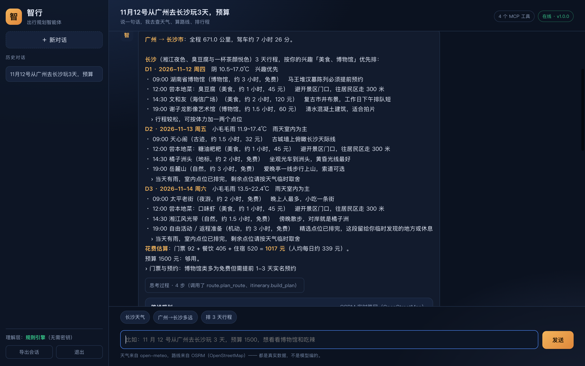

# 智行 · 出行规划智能体

> **你说一句，我做一路。**
> 广东工业大学 计算机学院 计科 24 级 78 班 · 软件工程 · 团队项目第一次作业
> 在线演示：（部署后填写）　｜　需求文档：[docs/需求规格说明书.md](docs/需求规格说明书.md)

一个**能说也会做**的出行助手：用户用自然语言说出需求，智能体自己决定该查天气、算路线还是排行程，
调用真实接口拿数据，再排成一张能照着走的逐日行程表。

三件事是真的：**天气**（open-meteo 16 天预报）、**里程**（OSRM 真实路网）、**地点**（高德 POI，配 Key 后全国可搜）。
每次调用了哪个工具、参数是什么、花了多少毫秒，界面上都能展开核对。



---

## 1 快速开始

### 前置条件（三样，缺一样跑不完整）

| 需要 | 用来做什么 | 缺了会怎样 |
|---|---|---|
| **Node 22+** + `pi` | 智能体引擎（Pi agent harness） | 自动走**降级模式**：规则理解 + 真实工具调用，仍能出完整行程卡片 |
| **模型凭据** | Pi 调用大模型做决策 | 同上——降级模式，回复末尾明确标注「不是 Pi 智能体」 |
| **`AMAP_KEY`** | 高德 POI 检索（全国地点） | POI 退回 `data/cities.json` 的 9 城示例，界面标注「示例数据」，**地图画不出来**（示例点位没有经纬度） |

凭据统一放项目根的 `.env`（已在 `.gitignore`，不会入库），启动时自动读取：

```ini
# .env
DASHSCOPE_API_KEY=sk-xxx
LLM_BASE_URL=https://dashscope.aliyuncs.com/compatible-mode/v1
LLM_MODEL=deepseek-v4.1-flash
PI_PROVIDER=dashscope
PI_MODEL=deepseek-v4.1-flash
AMAP_KEY=
```

`.env` 里的 `DASHSCOPE_API_KEY` 会被 Pi 的 `~/.pi/agent/models.json` 用 `$DASHSCOPE_API_KEY`
插值读取，所以 Key 不用写死在任何配置文件里。

```bash
# 1) 装引擎
npm i -g @earendil-works/pi-coding-agent

# 2) 配模型凭据（任选其一，Pi 支持 15+ 供应商）
export ANTHROPIC_API_KEY=sk-ant-xxx      # 或 OPENAI_API_KEY / 其他

# 3) 配高德 Key（申请时平台必须选「Web服务」，不是「Web端(JS API)」）
export AMAP_KEY=你的32位key

# 4) 起服务
cd zhixing-travel-agent
python3 server.py
```

打开 http://127.0.0.1:8000 ，体验账号 `demo` / `demo1234`。

**后端与前端都不需要安装任何 Python / JS 依赖**（标准库 + 原生 JS），
但要能对话，Pi 引擎和模型凭据是硬前置——这是选型代价，见 §3。

### 环境变量

| 变量 | 默认 | 说明 |
|---|---|---|
| `PORT` | 8000 | 端口 |
| `BIND` | 127.0.0.1 | 想让别人从别的设备访问就设 `0.0.0.0` |
| `DB_PATH` | data/zhixing.db | SQLite 文件位置 |
| `AMAP_KEY` | 空 | 高德 Web 服务 Key；不填则 POI 走本地示例数据 |
| `PI_BIN` | `pi` | pi 可执行文件；没全局装时可写 `node /path/to/cli.js` |
| `PI_MODEL` | 空 | 指定模型，如 `deepseek-chat`；留空用 Pi 默认 |
| `PI_PROVIDER` | 空 | 指定 provider，如 `anthropic` / `openai` |
| `PI_TIMEOUT` | 120 | 单轮等待上限（秒） |
| `PI_MAX_SESSIONS` | 6 | 同时存活的长驻子进程上限 |

```bash
# 让同宿舍的同学/老师的手机能打开
BIND=0.0.0.0 python3 server.py

# pi 只在临时目录装过，没进 PATH 时
PI_BIN="node /path/to/node_modules/@earendil-works/pi-coding-agent/dist/bundle/cli.js" \
PI_MODEL=deepseek-chat python3 server.py
```

## 2 它能做什么

| 你说 | 它做 |
|---|---|
| 长沙未来三天天气 | 调 `weather.get_forecast`，返回真实预报 + 带伞建议 |
| 从广州到长沙怎么走，开车要多久 | 调 `route.plan_route`，OSRM 真实路网里程与耗时，提示「该改高铁」 |
| 11 月 12 号从广州去长沙玩 3 天，预算 1500，想逛博物馆和吃辣 | **先算路线、再排行程**（两次工具调用），输出逐日行程 + 三餐 + 酒店 + 四项预算 |
| 泉州两天怎么玩 | 高德实时搜 POI，不再受 9 城限制（配 `AMAP_KEY` 后） |
| 帮我排个行程 | 不猜城市，直接追问目的地 |

排行程时读未来天气：**那天下雨就换室内点位**；室内排完了会如实说
「剩余点位请按天气临时取舍」，不会假装排得下。

预算拆四项：**门票 / 住宿 / 餐饮 / 市内交通**。住宿价按档位估算并标注「估算」，
门票取高德人均消费字段且注明「多数景点该字段为空」——不拿编出来的数字充准确。

### 行程地图

`itinerary` 卡片下方按天渲染地图（Leaflet + **高德瓦片**，CDN 引入，后端不加依赖）：

- 每天一种颜色，编号 marker 对应当天第几个点位，点开显示名称、时间、地址
- 同一天的点位按顺序虚线相连，自动 `fitBounds` 到所有点位
- **瓦片用高德**：国内访问稳定、自带中文标注，而且它和我们的 POI 同为 GCJ-02 坐标系，
  坐标天然对齐不用转换。之前用 OSM 瓦片时国内请求被拦，地图只有白底和 marker。
- WGS-84 数据进来时会补一次正变换（`GCJ.toGcj`），否则整体偏移几百米
- Leaflet 没加载成功（断网）时只降级成一行提示，不影响行程内容

### 交互与记忆

| 功能 | 说明 |
|---|---|
| **明暗主题** | 右上角图标切换，亮色是暖色调（米白纸感 + 焦糖橙）。选择存 localStorage，首次访问跟随系统偏好 |
| **会话管理** | 会话项右侧 `⋯` 呼出菜单：重命名 / 导出 Markdown / 删除。删除会二次确认 |
| **Markdown 渲染** | 自己实现的渲染器，支持标题、有序/无序列表、表格、代码块、行内代码、加粗、斜体、引用、分隔线、链接。先转义再拼标签，模型输出不会变成 HTML 注入 |
| **流式进度** | 走 SSE（`/api/chat/stream`），把 Pi 的事件流转成 `stage / tool / delta / done`。界面上能看到「正在调用 weather.get_forecast（第 1 个工具）…」和逐字输出，不是假的进度动画 |
| **双击 ESC 打断** | 第一次按提示「再按一次可以打断」，800ms 内再按就发 `abort`。已经吐出来的文字保留，末尾标「已打断」；打断过的进程下一轮自动重建 |
| **设置页** | 左上角齿轮图标。可改模型 Key / 高德 Key / 模型名，写回 `.env` 并立即生效（改模型会重建引擎进程）。Key 只以 `7fce****4954` 形式回显。退出登录也收在这里 |
| **长期记忆** | 见下 |
| **行程编辑** | 每天标题旁「调整」，进入后可对景点上移 / 下移 / 删除，改完再导出 |
| **导出** | 卡片上「导出」菜单：图片 PNG / PDF（html2canvas + jsPDF）/ **完整攻略 HTML** / **攻略 docx**。导出图片时自动隐藏地图——canvas 瓦片截出来多半是空白 |
| **侧边导航** | 卡片顶部 `D1 D2 D3` 按钮，点了平滑滚到对应那天 |
| **附件上传** | 输入框左下角 `+`：图片、PDF、Word、txt/md/csv，单个 8MB 以内 |
| **专家会诊** | 模型自己判断要不要开；意见由主智能体消化进回答，不单独列出 |
| **交付文件** | 排完行程自动生成网页攻略 + Word 文档，卡片可直接打开 |
| **会话标题** | 由模型读首轮问答概括，不是截首句话 |
| **设置页** | 切换栏分三页：API 配置 / 长期记忆 / 账号 |

### 长期记忆：Pi 做什么、我们做什么

先查清楚了再动手，没有重复造轮子：

- **Pi 已有**：`--session-id` 会话持久化。同一个会话里多轮上下文由 Pi 自己维护（实测第二问能答出第一问说的城市），关掉进程再开会话也能恢复。**这部分直接用，我们没写一行历史拼接。**
- **Pi 没有**：跨会话的用户档案。换一个新会话，它就不知道你常住哪、不吃什么。这部分用 SQLite 补。

实现方式：

```
用户说「我常住广州，预算一般 1500」
        ↓ 规则预筛（命中"我住/我预算"等词才触发，省钱）
        ↓ 一次独立的轻量模型调用抽成 {key: 常住城市, value: 广州}
   SQLite memories 表（按用户隔离）
        ↓ 每轮对话前
   prompt 前缀 [我对你的长期了解] → Pi
```

抽取是**异步**的，不拖慢回复；抽失败就静默跳过——记忆是加分项，不能因为它把对话搞坏。
设置页里可以看全部记忆、手动增删、一键清空。

### 文件上传

支持**图片**与**文档**：

| 类型 | 处理方式 |
|---|---|
| png/jpg/webp/gif | 调视觉模型描述一遍（实测能认出地图上的道路与地名），把描述注入对话 |
| txt/md/csv/json | 直接读文本 |
| docx | 解 zip 读 `word/document.xml`，按 `<w:t>` 抽正文 |
| pdf | 解 FlateDecode 流抓 `Tj/TJ` 文本；扫描件抽不出会明确告知 |

**为什么不直接把图片塞给 Pi**：Pi 的 RPC `prompt` 只接受字符串，塞不进二进制。
所以服务端先转成文字再注入——Pi 那边一行都不用改。

### 攻略产出：HTML 与 docx

用户要「完整攻略」时，行程卡片上的「导出」菜单可以生成：

- **HTML**：独立文件（`static/guides/*.html`），渐变头图、四格统计、每日表格、预算表、脚注口径说明。
  双击就能看，不依赖本应用，可以直接发给同伴或交作业。
- **docx**：手写 OOXML（zip 里塞 `[Content_Types].xml` / `_rels/.rels` / `word/document.xml`），
  **不引 python-docx**。标题、表格、备注齐全，能在 Word/WPS 里继续编辑。

注意文件名只用 ASCII：URL 里带中文会让不少 HTTP 客户端在编码处直接报错（踩过）。

### 专家会诊：让模型自己决定要不要开

你可能会问为什么不直接做成固定流水线。因为：

```
「泉州两天怎么玩」        → 直接 itinerary，20 秒
「做份完整攻略，能照着走」 → 会诊 + itinerary，80 秒
```

固定流水线会让第一句也等 80 秒。所以把它做成一个**工具** `expert.convene`，
由主智能体看情况决定调不调——工具描述和 SYSTEM.md 里都写清了判断标准。

会诊内部是三位专家（景点 / 天气 / 酒店）**并行**发言：

- 数据由 Python 先查好（POI、天气、酒店），专家只负责判断，不负责找数据
- 每个专家 = 一次独立模型调用 + 一个角色提示词，互不共享上下文
- 三位并行后约 20 秒（串行要 45 秒）
- 没有"行程规划师"：排程交给 `itinerary` 工具，避免重复劳动

**为什么不用 4 个 Pi 子进程**：Pi 子进程会再拉起 MCP server，形成无限递归。
所以专家是"角色 + 一次调用"，不是"另一个 agent 进程"。

**专家意见不出现在界面上。** 三份意见是给主智能体消化的素材，由它合并、权衡、
改写成连贯的一段回答；前端不会渲染成「景点专家说…」的列表。
理由是：用户要的是结论，不是三份互相矛盾的会议纪要——把判断甩给用户等于没做判断。
如果专家之间冲突，主智能体直接给取舍和理由。

### 交付物：排完行程就有文件

排出行程后，后端会自动把行程渲染成**网页版攻略**和 **Word 文档**，作为一张文件卡片
跟着回答一起返回，不需要用户再点「导出」：

```
itinerary 卡片出现
      ↓ orchestrator._deliver()
static/guides/trip-2day-<id>.html   渐变头图 + 每日表格 + 预算表，独立文件
static/guides/trip-2day-<id>.docx   手写 OOXML，Word/WPS 可编辑
      ↓
cards 末尾追加 {"type": "files"}    前端渲染成可点击的两行
```

放在服务端自动做而不是等用户点按钮：对话里给完结论就该有成品，多一步点击就多一次流失。
生成失败只是少一张卡片，不影响这轮对话。

### 会话标题由模型概括

原来截首句前 18 个字，结果列表里十条会话长得都一样（「帮我排一下长沙三天…」）。
现在首轮答完后，后台起一个线程，把「用户原话 + 回答开头」交给模型概括成 ≤12 字：

```
帮我排泉州两天行程，预算1200，想看古建筑  →  泉州两日古建筑攻略
长沙未来三天天气怎么样                     →  长沙未来三天天气查询
```

要点：**异步**（不拖慢本轮回复，约 2 秒后写库，前端 6 秒后刷一次列表）、
**有兜底**（模型失败就保留截断标题，绝不因为起标题把对话搞挂）。

## 3 架构

```
浏览器（原生 HTML/CSS/JS，无构建）
        │ fetch + Cookie
server.py（标准库 ThreadingHTTPServer：路由 / 鉴权 / 静态文件 / MCP 网关）
        │ JSONL over stdin/stdout
   agent/pi_bridge.py  ──  启动 pi 子进程、收发 RPC、把事件翻译成 steps/cards
        │
   pi --mode rpc --no-session --no-builtin-tools
        │ MCP stdio（Pi 内置 MCP 支持）
   mcp/server_stdio.py  ──  同一份工具表，外部 MCP 客户端也能挂
        │ registry.call_tool
   mcp/tools/  geo · poi · hotel · weather · route · itinerary
        │
   外部服务 ──  open-meteo（天气/地名）· OSRM（路网）· 高德（POI/酒店）
        │
   db.py  ──  SQLite：users / sessions / messages / tokens
```

### 为什么用 Pi，以及它的代价

Pi 是一个 agent harness（agent 运行时），负责工具调用循环、重试、上下文压缩、steering。
我们让它以 RPC 模式跑在子进程里，通过官方内置的 MCP 支持挂载自己的工具：

```bash
pi --mode rpc --no-session --no-builtin-tools
```

- `--mode rpc`：JSONL over stdin/stdout，官方为「非 Node 集成」准备，Python 可直接驱动
- `--no-builtin-tools`：关掉 Pi 自带的 read / write / edit / bash——它本职是编程助手，
  关掉之后只剩我们的业务工具，等于裁成一个领域 agent
- 系统提示放在项目根的 `SYSTEM.md`，不走命令行参数（避免 Windows 下中文经 cmd 转义出问题）

**两条链路，一套输出结构**：

```
            ┌─ 有 pi + 模型凭据 → Pi 智能体（自己决定调哪个工具、几次）
用户输入 ───┤
            └─ 否则 → agent/fallback.py（规则理解 + 直接调工具）
                              ↓
                    都是 (reply, steps, cards)，前端不区分
```

降级模式会在回复末尾和步骤区显式标注，不冒充智能体。模型凭据报 401/403 后冷却 120 秒，
期间直接走降级，不再每轮白等一次失败。

**代价说清楚**：引入 Pi 意味着 `python3 server.py` 不再是唯一前置，还需要 Node、pi、
模型凭据才能拿到"真正的智能体"体验。换来的是多轮工具编排、失败重试和上下文管理，
而不是写死的 `if/elif`。

其他取舍：

- **前端零构建**：原生 JS 360 行，没有 Vite/Webpack，答辩机房打不开 npm 也能演示界面。
- **工具层用 MCP**：同一份工具表既能被 Pi 调用，也能被 Claude Desktop 等外部客户端挂载。
- **诚实优先**：估算就标估算；没取到就说没取到；POI 降级时界面显式标注「示例数据」。
  这条是硬约束——参照项目在失败时生成 `北京景点1`、坐标 `116.4 + i*0.01`，我们不这么做。

## 4 MCP 工具

| 工具 | 作用 | 数据源 |
|---|---|---|
| `geocode.search_city` | 地名 → 经纬度/行政区 | open-meteo geocoding |
| `poi.search_places` | 按关键词搜城市内的地点（名称/地址/坐标/评分/照片） | 高德 Web 服务（未配 Key 时本地示例） |
| `poi.get_detail` | 单个地点详情（营业时间/评分/人均/照片） | 高德 |
| `poi.geocode` | 地址 → 坐标（GCJ-02） | 高德 |
| `hotel.search` | 酒店检索，价格按档位估算 | 高德 + 档位估算 |
| `weather.get_forecast` | 未来 1-16 天天气 + 出行建议 | open-meteo forecast |
| `route.plan_route` | 两地里程与耗时 | OSRM（驾车真实路网） |
| `itinerary.build_plan` | 逐日行程（景点/三餐/酒店/四项预算） | POI + 酒店 + 天气 |

用 curl 直接按 MCP 协议调用（不需要登录）：

```bash
curl -s localhost:8000/api/mcp -d '{"jsonrpc":"2.0","id":1,"method":"tools/list"}'
curl -s localhost:8000/api/mcp -d '{"jsonrpc":"2.0","id":2,"method":"tools/call",
  "params":{"name":"poi.search_places","arguments":{"city":"泉州","keywords":"博物馆","limit":5}}}'
```

挂到 Claude Desktop 或 Pi：把 `mcp/server_stdio.py` 按文件头说明写进
`claude_desktop_config.json` 或 `~/.pi/agent/mcp.json`（Pi 需设 `"exposure": "direct"`，
否则工具默认走 codemode，模型看不到）。

## 5 验收

```bash
python3 server.py                  # 终端 A
python3 tests/acceptance.py        # 终端 B
```

脚本对**真实运行的服务**发断言，分两层：

- **工具层**（走 `/api/mcp`）：结果确定，不受模型波动影响。天气、路线、POI、酒店、行程、预算四拆都在这一层。
- **智能体层**（走 `/api/chat`）：需要 Pi + 模型凭据。没就绪时标 **SKIP** 而不是 FAIL，
  因为那是部署环境问题，不是代码缺陷。

最近一次运行（2026-11-07，Windows / Python 3.13 / 阿里云百炼 DeepSeek / 高德 Key 已配）：

```
通过 59 项，失败 0 项，跳过 0 项
全部通过 ✅
```

覆盖：工具层真实数据（天气/路线/POI/酒店/行程/预算四拆）、Pi 智能体编排、
流式事件、设置脱敏、记忆读写与用户隔离、打断接口、鉴权与会话隔离、MCP 协议、安全。

实测响应：Pi 单工具轮约 9–10 秒；多步编排（天气 + POI + 酒店 + 行程）约 20–25 秒；
降级模式 1.8–3.2 秒。

## 6 目录结构

```
zhixing-travel-agent/
├─ server.py                 唯一入口：HTTP 服务 + 路由 + MCP 网关
├─ config.py                 配置（全部可用环境变量覆盖）
├─ SYSTEM.md                 Pi 的系统提示（领域角色与诚实约束）
├─ db.py                     SQLite 数据层（账号/会话/消息/token）
├─ agent/
│  ├─ pi_bridge.py           Pi 引擎桥接：子进程 / 会话池 / 事件翻译
│  ├─ orchestrator.py        编排层：把 Pi 事件流翻成 steps 与 cards
│  ├─ fallback.py            降级链路：Pi 不可用时走规则 + 真实工具
│  └─ nlu.py                 规则理解层（意图分类 + 槽位抽取）
├─ llm/
│  └─ __init__.py            大模型接入（Pi 接入后仅作历史保留）
├─ mcp/
│  ├─ protocol.py            JSON-RPC 2.0 / MCP 消息
│  ├─ registry.py            工具注册表（校验、异常兜底、调用轨迹）
│  ├─ server_stdio.py        独立 MCP Server（stdio，可挂 Claude Desktop / Pi）
│  ├─ net.py                 标准库 HTTP 客户端（超时 + 重试）
│  └─ tools/
│     ├─ geo.py              地名解析（含同名村庄纠错）
│     ├─ poi.py              高德 POI 搜索 / 详情 / 地理编码
│     ├─ hotel.py            酒店检索（价格标注估算）
│     ├─ weather.py          天气（WMO 编码 → 中文）
│     ├─ route.py            路线（OSRM + 步行/骑行估算）
│     └─ itinerary.py        行程排程（兴趣打分 / 雨天改室内 / 四项预算）
├─ data/
│  ├─ cities.json            9 座城市 × 8 个点位（无 Key 时的降级数据集）
│  └─ zhixing.db             运行时生成的数据库
├─ static/                   前端（index.html / style.css / app.js）
├─ docs/
│  ├─ 需求规格说明书.md       按国标 SRS 结构写的需求文档
│  ├─ 团队展示与选题报告.md
│  ├─ 博客随笔.md            提交到班级博客的正文
│  └─ screenshots/
└─ tests/
   └─ acceptance.py          工具层 + 智能体层两层断言
```

## 7 已知局限

1. **规则理解层的能力边界**：降级模式靠关键词与正则，遇到很绕的说法会漏抽槽位。
   例如「我想找个地方躺几天」抽不出目的地，会反问而不是瞎猜。真正语义理解要靠 Pi + 模型。
2. **高德不提供门票与房价**：门票取 `biz_ext.cost`（多数景点为空），酒店价按档位估算，
   两者都在界面与接口里标注了口径。
3. 无 `AMAP_KEY` 时 POI 只覆盖 9 座城市，其余城市返回「通用框架」并提示；
   有 Key 后可覆盖全国，但未做分页与配额管理。
4. **坐标系**：高德返回 GCJ-02，OSRM 与 OSM 是 WGS-84。前端渲染前做了 GCJ-02 → WGS-84
   迭代反解（误差 < 1 米），否则整体偏移 100–600 米。无 `AMAP_KEY` 时本地示例点位没有经纬度，
   地图位置会显示一行文字说明而不是留白。
5. 步行/骑行耗时按直线距离估算，只有驾车走真实路网。
6. 天气最多 16 天，更远的日期显示「暂无预报」，不拿气候平均值猜测。
7. 单实例 SQLite、无速率限制、无找回密码——定位是课程原型，不是生产系统。

## 8 声明

本项目代码由本组独立实现，未复制同学仓库；使用的公开接口为 open-meteo、OSRM（免密钥公共服务）
与高德开放平台（需自行申请 Key）。`data/cities.json` 的示例点位为小组自行整理的公开景点信息。
智能体引擎使用开源的 [Pi](https://github.com/earendil-works/pi)（MIT）。
