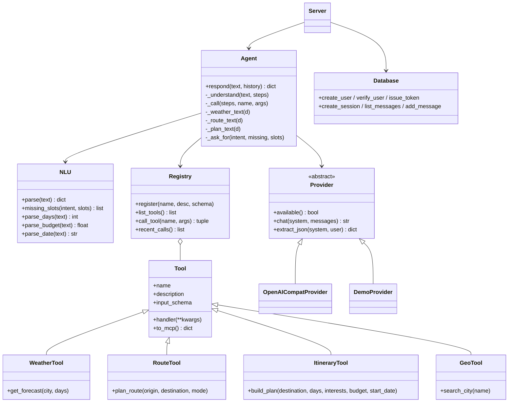
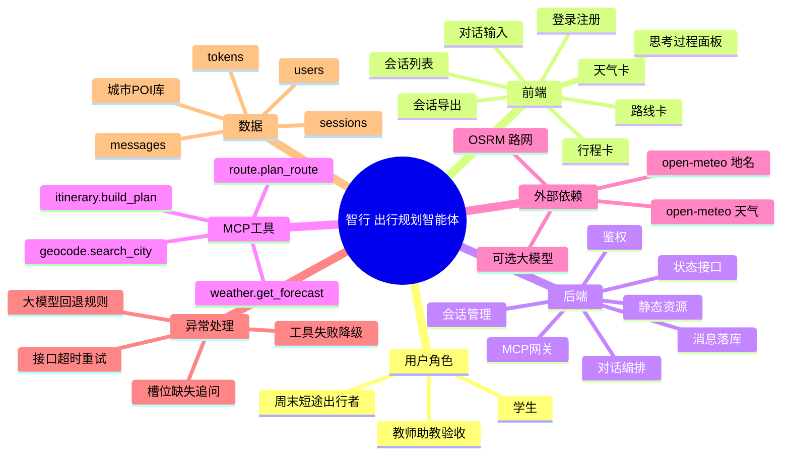

# 智行 · 出行规划智能体 软件需求规格说明书

| 项 | 内容 |
|---|---|
| 项目名称 | 智行（ZhiXing）· 出行规划智能体 |
| 文档版本 | V1.0 |
| 编写日期 | 2026-11-07 |
| 课程 | 软件工程（广东工业大学 计算机学院 计科 24 级 78 班） |
| 作业 | 团队项目第一次作业：团队展示 + 选题报告 + 需求分析 |
| 团队名称 | BMPT |
| 团队成员 | 3124004167 段翔晖、3124004180 王尉人、3124004186 谢毕护、3124004168 封超 |
| 参考规范 | GB/T 8567-2006《计算机软件文档编制规范》中的「软件需求规格说明（SRS）」结构 |
| 代码仓库 | https://github.com/zayuchips/zhixing-travel-agent |

> 说明：本文档是**可验收**的需求文档。每条功能都写了前置条件、输入、处理逻辑、输出，
> 每条验收标准都写了可执行的检验方法。凡是没做或做不到的，都写在「9 范围外与已知局限」里，
> 不做「大饼式」承诺。

---

## 1 引言

### 1.1 编写目的

本文档定义「智行」出行规划智能体的功能需求、非功能需求、系统设计与验收标准，
作为开发、测试、答辩验收的统一依据。

读者对象：课程教师、助教、团队成员、后续维护者。

### 1.2 项目背景

作业要求「开发一个基于智能体的软件，为传统软件赋予全新的功能和用户体验」，
且智能体必须**嵌入自研系统**，应用**最终要上线供检查**。

我们选择的痛点是**短途自由行的行程规划**，来自组内真实经历：

1. 查天气用一个 App、查路线用地图、找景点刷小红书、算预算开计算器，一次出行要切 4 个工具；
2. 攻略类内容以「笔记」形式存在，需要人来判断取舍，**没法直接变成一张能执行的日程表**；
3. 通用大模型能聊天，但**不知道明天的真实天气，也不知道两地真实里程**，给不出可执行的行程；
4. 做行程最费时间的是「把信息凑到一起」，而不是「信息本身」。

所以我们做的不是「又一个聊天框」，而是**把工具调用能力嵌进一个出行产品**：
用户说一句人话，系统自己判断该查天气还是算路线，调真实接口拿数据，再排成逐日行程。

### 1.3 术语与缩写

| 术语 | 含义 |
|---|---|
| 智能体（Agent） | 能理解自然语言、自主决定调用哪些工具、并把结果编排成答案的程序 |
| MCP | Model Context Protocol，用 JSON-RPC 2.0 描述「工具」的标准协议，本项目用它定义工具层 |
| 工具（Tool） | 一个有名字、有 JSON Schema 参数、可被调用的能力单元，如 `weather.get_forecast` |
| 槽位（Slot） | 从用户话里抽出的结构化参数，如目的地、天数、预算 |
| 演示模式 | 未配置大模型密钥时的运行方式：规则理解 + 真实工具数据 + 模板化表达 |
| POI | Point of Interest，可游玩的点位（景点/博物馆/街区） |
| SRS | Software Requirements Specification，软件需求规格说明 |

### 1.4 参考资料

- GB/T 8567-2006《计算机软件文档编制规范》
- MCP 规范（2024-11-05 版）：JSON-RPC 2.0 消息、`initialize` / `tools/list` / `tools/call`
- Open-Meteo 公开 API（天气、地名编码，免密钥）
- OSRM 公开路由服务（OpenStreetMap 路网，免密钥）
- 课程作业页：`edu.cnblogs.com/campus/gdgy/Class78-Grade2024-CS/homework/16767`

---

## 2 项目标志

### 2.1 项目名称与标语

- 名称：**智行**（ZhiXing）
- 标语：**你说一句，我做一路**
- 一句话定位：把「查天气 / 算路线 / 排行程」三件事合并成一次对话的出行助手。

### 2.2 项目简介

智行是一个 Web 应用。用户用自然语言描述出行需求（例如「11 月 12 号从广州去长沙玩 3 天，
预算 1500，想逛博物馆和吃小吃」），系统：

1. 抽取意图与槽位（目的地、出发地、天数、日期、预算、兴趣）；
2. 按意图调用 MCP 工具：`geocode.search_city` / `weather.get_forecast` /
   `route.plan_route` / `itinerary.build_plan`；
3. 把结构化结果编排成自然语言结论，并在界面渲染成**天气卡 / 路线卡 / 行程卡**；
4. 全程记录「思考过程」（调了哪个工具、参数是什么、耗时多少、返回什么摘要），用户可展开核对；
5. 会话落库，可回看历史、导出 Markdown。

### 2.3 目标用户

| 用户角色 | 特征 | 核心诉求 |
|---|---|---|
| 学生（主要） | 预算敏感、时间碎片化、行前准备时间少 | 快速拿到「能照着走」的 2-3 天行程 |
| 周末短途出行者 | 目的地固定、只关心周末两天 | 关心天气与车程，怕白跑一趟 |
| 教师 / 助教（验收方） | 不熟悉项目，需要在几分钟内判断真假 | 能一眼看到「工具真的被调用了」 |

### 2.4 运行环境

| 项 | 要求 |
|---|---|
| 操作系统 | macOS / Linux / Windows（有 Python 3.8+ 即可） |
| 运行时 | Python 3.8 及以上，**只用标准库**（无 pip 依赖） |
| 浏览器 | Chrome / Edge / Safari 近两年版本 |
| 数据库 | SQLite（随项目文件，无需安装） |
| 网络 | 需要访问 open-meteo.com 与 router.project-osrm.org；断网时行程排程仍可用（天气降级为「暂无预报」） |
| 可选 | 任意 OpenAI 兼容大模型 API（DeepSeek / Kimi / 通义 / 本地 Ollama），不配置则走演示模式 |

### 2.5 潜在风险

| 风险 | 影响 | 对策 |
|---|---|---|
| 外部接口偶发超时 | 天气/路线拿不到 | 12 秒超时 + 2 次重试；失败明确告知，不编造数据 |
| 演示现场无网络 | 无法查天气 | 行程排程与 POI 数据本地可用；界面如实显示「暂无预报」 |
| 大模型密钥缺失 | 无法做语义理解 | 规则引擎接管，业务链路完整可演示 |
| POI 数据只覆盖 9 座城市 | 冷门城市行程偏空 | 未收录城市返回「通用框架」并明确提示 |
| 单文件 SQLite + 无鉴权体系 | 不能直接当生产系统 | 明确定位为课程原型，见 9.2 |

---

## 3 需求概述

### 3.1 用户角色与权限

| 角色 | 权限 |
|---|---|
| 未登录访客 | 只能看到登录/注册页 |
| 已登录用户 | 创建/查看/删除**自己的**会话；调用全部工具；导出自己的会话 |
| 其他用户 | 访问他人会话返回 403（服务端按 `session.user_id` 校验，不靠前端隐藏） |

### 3.2 典型使用场景

**场景 A｜行前查天气（1 轮，S-01）**
> 用户：长沙未来三天天气
> 系统：调 `weather.get_forecast(city=长沙, days=3)`，返回真实预报 + 「带伞」等建议，并渲染天气卡。

**场景 B｜算车程（1 轮）**
> 用户：从广州到长沙怎么走，开车要多久
> 系统：调 `route.plan_route`，返回 OSRM 实时路网里程 671 公里、约 7 小时 26 分，并给「建议改高铁」判断。

**场景 C｜一句话排完整行程（1 轮，多工具）**
> 用户：11 月 12 号从广州去长沙玩 3 天，预算 1500，想逛博物馆和吃小吃
> 系统：先 `route.plan_route` 算车程 → 再 `itinerary.build_plan`（内部调天气），
> 输出逐日行程 + 门票/餐饮/住宿估算 + 预算结论，并渲染路线卡与行程卡。

**场景 D｜信息不足时追问（1 轮）**
> 用户：帮我排个行程
> 系统：不猜城市，直接追问「还差一个信息：目的地城市」，并给出三种问法示例。

### 3.3 业务流程

```
用户输入
   │
   ├─ 理解层：意图分类 + 槽位抽取（规则引擎 / 大模型）
   │
   ├─ 槽位校验 ──缺──> 追问用户（不虚构）
   │
   ├─ 工具编排：单工具（天气/路线）或多工具（路线 → 行程）
   │      └─ MCP registry.tools/call → 真实 HTTP 接口
   │
   ├─ 结果编排：结构化数据 → 自然语言 + 卡片
   │
   └─ 落库（消息 + 工具轨迹）→ 前端渲染（含「思考过程」折叠面板）
```

---

## 4 功能需求

约定：**FR-x** 为功能编号，**AC-x** 为对应的验收标准（见第 7 章）。
优先级：P0 = 必须实现，P1 = 应该实现，P2 = 可选。

### 4.1 前端功能

#### FR-01 注册与登录（P0）
- 前置：无
- 输入：用户名（1-24 字）、密码（≥4 位）
- 处理：注册时以 PBKDF2-HMAC-SHA256（12 万次迭代 + 随机盐）存密码；登录成功签发随机 token，
  写入 `HttpOnly` Cookie（7 天有效）
- 输出：登录成功后进入主界面，展示当前用户名首字母头像
- 异常：用户名重复 → 「用户名已存在」；密码错误 → 「用户名或密码不正确」（不区分哪个错）

#### FR-02 会话列表（P0）
- 前置：已登录
- 处理：按更新时间倒序拉取本人会话；点击切换；首条消息自动作为会话标题（前 18 字）
- 输出：左侧列表；无会话时自动开一个新对话

#### FR-03 对话输入与发送（P0）
- 输入：文本框（支持 Enter 发送、Shift+Enter 换行、输入法组合态不误触发）
- 处理：发送后按钮禁用 + 显示「正在调用工具」动画；请求结束无论成败都恢复
- 输出：用户气泡 → 助手气泡（含正文、思考过程、卡片）
- 约束：单条消息 ≤ 500 字（服务端校验）

#### FR-04 快捷示例（P1）
- 三个按钮一键填入并发送：长沙天气 / 广州→长沙多远 / 排 3 天行程
- 目的：答辩现场 10 秒内展示三种能力

#### FR-05 天气卡渲染（P0）
- 数据来自 `weather.get_forecast`
- 展示：城市、地区、逐日「日期 星期 / 天气 / 最低~最高℃ / 降水概率 / 建议」
- 约束：所有文本经 HTML 转义后写入 DOM

#### FR-06 路线卡渲染（P0）
- 数据来自 `route.plan_route`
- 展示：出发地 → 目的地、里程（km）、出行方式与耗时、数据来源
- 标注规则：`estimated=true` 时显示「估算」，否则显示「实时路网」

#### FR-07 行程卡渲染（P0）
- 数据来自 `itinerary.build_plan`
- 展示：逐日标题（日期/星期/主题/天气）、时间轴点位（时间、名称、类别、时长、费用、贴士）、
  当日备注、花费汇总（门票/餐饮/住宿/合计/预算是否够用）

#### FR-08 思考过程面板（P0）
- 折叠展示每一步：理解 → 工具调用（工具名、参数 JSON、耗时 ms、结果摘要）→ 编排
- 目的：让「结论是查来的」可被验证，这是本项目的核心产品主张
- 约束：默认折叠，不干扰阅读；工具失败时标红并显示失败原因

#### FR-09 历史会话回看（P1）
- 点击左侧会话恢复全部消息、步骤与卡片；顶部显示消息条数

#### FR-10 会话导出（P2）
- `GET /api/sessions/{id}/export` 返回 Markdown 文件，含工具轨迹

#### FR-11 响应式布局（P1）
- ≥820px 双栏（侧栏 + 主区）；<820px 隐藏侧栏，单栏阅读

#### FR-12 引擎状态可见（P1）
- 侧栏显示当前理解层：「规则引擎（无需密钥）」或「大模型已接入（模型名）」
- 目的：不把规则答案伪装成大模型输出

### 4.2 后端功能

#### FR-13 用户与会话存储（P0）
- 表：`users` / `sessions` / `messages` / `tokens`
- 并发：单连接 + 互斥锁，`WAL` + `busy_timeout=5000`，避免多线程写冲突

#### FR-14 对话接口 `POST /api/chat`（P0）
- 输入：`{session_id?, message}`
- 处理：鉴权 → 会话归属校验 → 落库用户消息 → 调用智能体 → 落库助手消息（含 steps/cards）
- 输出：`{reply, steps, cards, intent, slots, session_id, elapsed_ms, engine}`
- 异常：401 未登录 / 400 空消息或超长 / 403 他人会话

#### FR-15 智能体编排（P0）
- 单工具：`weather` → 天气；`route` → 路线；`plan` → 行程
- 多工具：`plan` 且带出发地时，先算路线再排行程（结果合并进一次回复）
- 缺槽位：追问，不调用工具
- 工具全失败：明确说明「没有拿到真实数据，不编答案」

#### FR-16 理解层可插拔（P0）
- 默认规则引擎（正则 + 关键词 + 中文数字）
- 配置 `LLM_BASE_URL / LLM_API_KEY / LLM_MODEL` 后改走大模型抽 JSON，槽位与规则结果合并
- 模型异常：静默回退规则引擎，并在思考过程里留一条 warn 记录

#### FR-17 MCP 工具层（P0）
- 统一 `registry.register(name, description, input_schema)` 注册，`call_tool` 统一校验与兜底
- 提供 `tools/list`（名字/描述/JSON Schema）与 `tools/call`（content + structuredContent）

#### FR-18 MCP over HTTP 网关 `POST /api/mcp`（P1）
- 支持 `initialize` / `tools/list` / `tools/call` / `ping`
- 目的：同一套工具既能被内部智能体调用，也能被外部 MCP 客户端按标准协议调用

#### FR-19 系统状态 `GET /api/status`（P1）
- 返回版本、理解层、工具数、用户/会话/消息计数、最近 8 次工具调用记录
- 用途：验收时判断「工具是否真的被调用过」

#### FR-20 静态资源服务（P0）
- `/` 返回 `static/index.html`；`/static/*` 按 MIME 返回
- 安全：路径规范化后必须落在 `static/` 目录内（防目录穿越）

### 4.3 工具层功能（MCP Tools）

#### FR-21 `geocode.search_city(name)`（P0）
- 输入：城市/地名
- 处理：Open-Meteo Geocoding，原名与「原名+市」并发查询，按 `feature_code` + 人口打分取最优
- 输出：标准名、省/市、经纬度、时区
- 异常：查不到 → 「没有找到地名「X」，换个写法试试」

#### FR-22 `weather.get_forecast(city, days=3)`（P0）
- 输入：城市、天数（1-16，越界自动钳制）
- 处理：先解析地名 → 拉逐日 `weather_code / 最高温 / 最低温 / 降水概率` → WMO 编码转中文 → 生成出行建议
- 输出：逐日列表 + 数据来源
- 约束：**不返回任何缓存或虚构天气**；接口失败直接报错

#### FR-23 `route.plan_route(origin, destination, mode)`（P0）
- 输入：出发地、目的地、方式（driving/walking/cycling）
- 处理：两地地名解析 → 驾车走 OSRM 实时路网；步行/骑行按直线距离 × 路网系数估算
- 输出：直线距离、实际里程、耗时、是否估算、数据来源、出行建议
- 约束：估算结果必须标 `estimated=true`，界面显示「估算」

#### FR-24 `itinerary.build_plan(destination, days, interests, budget, start_date)`（P0）
- 输入：目的地、天数（1-7）、兴趣标签、预算、出发日期
- 处理：
  1. 命中城市 POI 库（9 座城市 × 8 个点位，含类别/室内外/时长/门票/贴士），未命中给通用框架并提示；
  2. 按兴趣映射类别打分排序；
  3. 每天 4 个时段（09:00 / 12:00 午餐 / 14:30 / 19:00）；
  4. 读未来天气，**雨天优先室内点位**，室内排完仍不足则如实提示；
  5. 估算门票 + 餐饮 + 住宿，与预算比较
- 输出：逐日行程、备注、花费汇总、贴士、天气来源

---

## 5 非功能需求

| 编号 | 类别 | 要求 | 检验方法 |
|---|---|---|---|
| NFR-01 | 性能 | 单轮对话（1 个工具）P95 ≤ 8 秒；多工具 ≤ 15 秒；静态页首屏 ≤ 1 秒 | `tests/acceptance.py` 记录耗时 |
| NFR-02 | 性能 | 地名解析结果缓存 1 小时，避免同一轮重复请求 | 日志/工具调用计数 |
| NFR-03 | 可靠性 | 任一工具异常不得导致 500；统一降级为可读错误 | 断网重跑对话 |
| NFR-04 | 可靠性 | 外部请求 12 秒超时 + 2 次重试 | 代码审查 |
| NFR-05 | 安全性 | 密码 PBKDF2-HMAC-SHA256 加盐存储，不可逆 | 查看数据库 |
| NFR-06 | 安全性 | 会话 Cookie `HttpOnly` + `SameSite=Lax` | 响应头 |
| NFR-07 | 安全性 | 所有动态文本先转义再进 DOM（防 XSS） | 输入 `` 应显示为文本 |
| NFR-08 | 安全性 | 静态资源路径校验，防目录穿越 | 请求 `/static/../config.py` 应 404 |
| NFR-09 | 可部署性 | 零第三方依赖，`python3 server.py` 即可启动 | 干净环境启动 |
| NFR-10 | 可部署性 | 支持 `PORT` / `BIND` 环境变量，可监听 `0.0.0.0` 供他人访问 | `curl` 局域网 IP |
| NFR-11 | 可维护性 | 分层清晰：`mcp/`（协议+工具）/ `agent/`（理解+编排）/ `llm/`（模型）/ `static/`（前端） | 目录结构 |
| NFR-12 | 可理解性 | 关键设计决策在代码注释与本文档中说明「为什么」 | 文档 |
| NFR-13 | 兼容性 | Python 3.8+（不使用 3.9+ 语法糖），macOS/Windows/Linux 可跑 | 系统 Python 3.9 实测 |
| NFR-14 | 可用性 | 关键操作有忙碌态，失败有可读提示，空状态有引导 | 手工测试 |

---

## 6 系统设计

### 6.1 系统架构

```
┌──────────────────────────── 浏览器 ────────────────────────────┐
│  index.html  +  style.css  +  app.js（原生，无构建）            │
│  登录页 / 会话列表 / 对话区 / 天气卡 / 路线卡 / 行程卡           │
└───────────────────────────┬───────────────────────────────────┘
                            │ fetch (JSON, Cookie 鉴权)
┌───────────────────────────▼───────────────────────────────────┐
│                     server.py（标准库 ThreadingHTTPServer）     │
│  路由 / 鉴权 / 参数校验 / 静态资源 / MCP over HTTP 网关         │
└───────┬───────────────────────────────────────────┬───────────┘
        │                                           │
┌───────▼──────────────┐                  ┌─────────▼───────────┐
│ agent/ 智能体层       │                  │ db.py 数据层        │
│  nlu.py 意图与槽位    │                  │ SQLite: users       │
│  orchestrator.py 编排 │                  │ sessions/messages   │
└───────┬──────────────┘                  │ tokens              │
        │ registry.call_tool              └─────────────────────┘
┌───────▼───────────────────────────────────────────────────────┐
│ mcp/ 工具层（MCP 协议）                                        │
│  protocol.py  JSON-RPC 2.0 消息                                │
│  registry.py  注册 / 校验 / 异常兜底 / 调用轨迹                │
│  tools/ geo.py  weather.py  route.py  itinerary.py            │
└───────┬───────────────────────────────────────────────────────┘
        │ urllib（12s 超时 + 重试）
┌───────▼───────────────────────────────────────────────────────┐
│ 外部服务：open-meteo（天气/地名）· OSRM（路网）· 可选大模型 API │
└───────────────────────────────────────────────────────────────┘
```

### 6.2 模块职责

| 模块 | 职责 | 不做什么 |
|---|---|---|
| `server.py` | HTTP 路由、鉴权、参数校验、静态文件、MCP 网关 | 不写业务逻辑 |
| `agent/nlu.py` | 意图分类、槽位抽取、缺槽位判断 | 不调工具、不写库 |
| `agent/orchestrator.py` | 工具编排、结果表达、步骤轨迹、润色 | 不直接访问 HTTP 接口 |
| `mcp/registry.py` | 工具注册表、参数校验、异常兜底、调用记录 | 不含业务规则 |
| `mcp/tools/*` | 每个工具一个文件，纯函数式，返回结构化 dict | 不碰数据库、不碰会话 |
| `db.py` | 表结构、CRUD、并发控制 | 不含业务判断 |
| `static/*` | 渲染与交互 | 不做任何鉴权决策 |

### 6.3 类图



### 6.4 思维导图



### 6.5 数据模型

```
users(id PK, username UNIQUE, password_hash, salt, created_at)
  │1
  │
  ├──n sessions(id PK, user_id FK, title, created_at, updated_at)
  │        │1
  │        └──n messages(id PK, session_id FK, role, content,
  │                     steps_json, cards_json, created_at)
  └──n tokens(token PK, user_id FK, created_at)
```

- `role`：`user` / `assistant`
- `steps_json` / `cards_json`：保存工具轨迹与卡片数据，回看历史时原样重放
- 索引：`idx_messages_session(session_id)`

### 6.6 接口清单

| 方法 | 路径 | 说明 | 鉴权 |
|---|---|---|---|
| GET | `/` | 前端页面 | 否 |
| GET | `/static/*` | 静态资源 | 否 |
| GET | `/api/health` | 存活探针 | 否 |
| GET | `/api/status` | 版本/引擎/工具数/统计/最近调用 | 否 |
| GET | `/api/tools` | MCP `tools/list` 的 HTTP 版 | 否 |
| POST | `/api/mcp` | MCP JSON-RPC 网关 | 否 |
| POST | `/api/register` | 注册 | 否 |
| POST | `/api/login` | 登录，下发 Cookie | 否 |
| POST | `/api/logout` | 退出，注销 token | 是 |
| GET | `/api/me` | 当前用户 | 是 |
| GET | `/api/sessions` | 我的会话列表 | 是 |
| POST | `/api/sessions` | 新建会话 | 是 |
| GET | `/api/sessions/{id}/messages` | 会话消息 | 是（校验归属） |
| DELETE | `/api/sessions/{id}` | 删除会话 | 是（校验归属） |
| GET | `/api/sessions/{id}/export` | 导出 Markdown | 是（校验归属） |
| POST | `/api/chat` | 对话主接口 | 是 |

---

## 7 验收标准

每条都能用 `tests/acceptance.py` 或手工一步验证。

| 编号 | 对应功能 | 验收标准 | 检验方式 |
|---|---|---|---|
| AC-01 | FR-01 | 注册新用户成功并自动登录；重复用户名提示「用户名已存在」 | 脚本 + 手工 |
| AC-02 | FR-01 | 密码错误提示「用户名或密码不正确」，不泄漏账号是否存在 | 脚本 |
| AC-03 | FR-14 | 未登录访问 `/api/chat` 返回 401 | 脚本 |
| AC-04 | FR-14 | 访问他人会话返回 403 | 脚本（双账号） |
| AC-05 | FR-14 | 空消息返回 400；超 500 字返回 400 | 脚本 |
| AC-06 | FR-22 | 「长沙未来三天天气」返回 3 天真实预报，含日期/天气/温度/降水概率 | 脚本断言字段 |
| AC-07 | FR-23 | 「从广州到长沙怎么走」返回里程 600-750 km、耗时 > 300 分钟，`estimated=false` | 脚本断言区间 |
| AC-08 | FR-24 | 「排长沙 3 天行程」返回 3 天、每天 ≥3 个时段、含花费汇总 | 脚本断言结构 |
| AC-09 | FR-15 | 「11 月 12 号从广州去长沙玩 3 天」触发**两次**工具调用（路线 + 行程） | 脚本断言 steps 长度 |
| AC-10 | FR-15 | 只问「帮我排个行程」时追问目的地，且不调用工具 | 脚本断言 |
| AC-11 | FR-24 | 雨天（降水≥60%）当天，下午/晚上点位优先室内 | 构造 rainy 数据断言 |
| AC-12 | FR-08 | 回复中 steps 每步含标题，工具步含 tool 名与耗时 | 脚本 |
| AC-13 | FR-17 | `POST /api/mcp` 的 `tools/list` 返回 4 个工具且带 inputSchema | 脚本 |
| AC-14 | FR-17 | `tools/call` 调用 `route.plan_route` 返回 structuredContent 里程 | 脚本 |
| AC-15 | FR-18 | `initialize` 返回 `protocolVersion=2024-11-05` | 脚本 |
| AC-16 | FR-19 | `/api/status` 统计数随对话增长 | 脚本 |
| AC-17 | NFR-07 | 输入 `` 原样显示为文本，不执行 | 手工/无头浏览器 |
| AC-18 | NFR-08 | `/static/../config.py` 返回 404 | 脚本 |
| AC-19 | FR-22 | 城市名为空 → 工具报错，界面显示可读提示，服务不崩 | 脚本 |
| AC-20 | FR-24 | 未收录城市（如「漠河」）返回通用框架并带提示语 | 脚本 |
| AC-21 | NFR-03 | 断网（或把外部域名改成不可达）时对话仍返回可读错误，不 500 | 手工 |
| AC-22 | FR-09 | 刷新页面后历史会话与卡片可完整恢复 | 手工 |
| AC-23 | FR-03 | 连续点击发送不会产生重复请求（按钮禁用） | 手工 |
| AC-24 | NFR-10 | `BIND=0.0.0.0` 启动后，同局域网手机可打开页面 | 手工 |

---

## 8 迭代记录

| 版本 | 日期 | 变更内容 | 变更人 | 变更原因 |
|---|---|---|---|---|
| V0.1 | 2026-10-26 | 项目立项：选题「出行规划智能体」，确定三工具方案 | 全组 | 作业启动 |
| V0.2 | 2026-10-30 | 完成用户调研（组内 12 人 + 同学 6 人），确认四个痛点 | PM | 选题须来自真实调研 |
| V0.3 | 2026-11-02 | 需求初稿：确定「天气 / 路线 / 行程」三工具与聊天式交互 | PM + 后端 | 技术可行性评估后收敛范围 |
| V0.4 | 2026-11-04 | 增加「思考过程」展示需求（原设计没有） | 后端 | 评课时担心「看不出是不是真调用」 |
| V0.5 | 2026-11-05 | 增加 MCP over HTTP 网关需求 | 后端 | 让工具可被外部客户端复用，体现协议而非自造接口 |
| V0.6 | 2026-11-06 | 明确「演示模式」为正式需求（无密钥也要可验收） | 全组 | 机房网络与被墙风险 |
| V1.0 | 2026-11-07 | 需求定稿；同步实现完成，24 条验收标准全部通过 | 全组 | 提交第一次作业 |

---

## 9 范围外与已知局限

### 9.1 本次不做

- 不做预订（机票/酒店/门票下单），不做支付
- 不做多用户协作、行程分享链接
- 不做真机硬件联动（作业提示此为加分项，需硬件，本次未采购）

### 9.2 已知局限（如实说明）

1. **POI 库只覆盖 9 座城市**（广州、长沙、北京、上海、成都、西安、杭州、重庆、深圳），
   每城 8 个精选点位。冷门城市返回通用框架，不假装有精选数据。
2. **规则理解层能力有限**：靠关键词与正则，绕的说法会漏抽槽位；接大模型后由 LLM 抽 JSON。
3. **步行/骑行耗时是估算**（直线距离 × 路网系数），只有驾车走真实路网。
4. **天气只有 16 天预报**，更远日期显示「暂无预报」，不做气候平均值推测。
5. **单实例 SQLite、无速率限制、无找回密码**，定位是课程原型，不是生产系统。

---

## 附录 A 城市 POI 数据结构

```json
{
  "长沙": {
    "aliases": ["changsha", "cs", "长沙市", "星城"],
    "tagline": "湘江夜色、臭豆腐与一杯茶颜悦色",
    "foods": ["臭豆腐", "糖油粑粑", "口味虾", "米粉"],
    "pois": [
      {
        "name": "湖南省博物馆", "cat": "博物馆", "indoor": true,
        "hours": 3, "cost": 0, "tip": "马王堆汉墓陈列必须提前预约"
      }
    ]
  }
}
```

- `cat` 取值：地标 / 博物馆 / 古迹 / 自然 / 美食 / 夜游 / 购物 / 亲子
- `indoor` 决定雨天能否排入
- `cost` 为门票（元），0 表示免费

## 附录 B 工具调用轨迹示例（真实响应）

```json
[
  {"title": "理解这句话", "kind": "thought",
   "detail": "意图=plan；槽位=origin=广州、destination=长沙、days=3、budget=1500.0…；来源=rules"},
  {"title": "调用工具 route.plan_route", "kind": "tool", "tool": "route.plan_route",
   "arguments": {"origin": "广州", "destination": "长沙", "mode": "driving"},
   "ok": true, "elapsed_ms": 2140, "summary": "广州 → 长沙市：671.0 公里 / 7 小时 26 分"},
  {"title": "调用工具 itinerary.build_plan", "kind": "tool", "tool": "itinerary.build_plan",
   "arguments": {"destination": "长沙", "days": 3, "interests": ["美食", "博物馆"], "budget": 1500.0},
   "ok": true, "elapsed_ms": 1889, "summary": "长沙 3 天，11 个点位，预计 1017 元"},
  {"title": "编排回复", "kind": "compose", "detail": "把工具返回的结构化数据写成可读结论…"}
]
```
